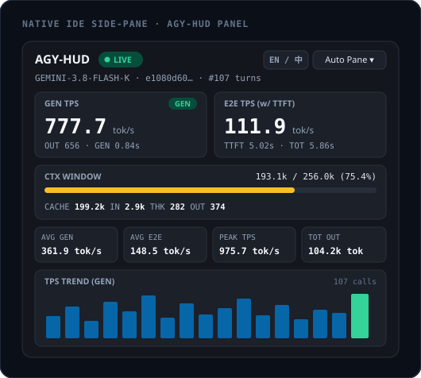

<div align="center">


<p>
  <strong>Real-time token speed, TTFT, actual routed model ID, and context window monitor for Google Antigravity</strong>
</p>

<p>
  <a href="LICENSE"></a>
  
  
  
  
  
</p>

<p>
  <strong>English</strong> ·
  <a href="README.zh-CN.md">简体中文</a> ·
  <a href="README.ja.md">日本語</a> ·
  <a href="README.ko.md">한국어</a> ·
  <a href="README.es.md">Español</a> ·
  <a href="README.fr.md">Français</a> ·
  <a href="README.de.md">Deutsch</a> ·
  <a href="README.ru.md">Русский</a>
</p>

<p>
  <a href="#overview">Overview</a> ·
  <a href="#quick-start">Quick Start</a> ·
  <a href="#protobuf-map">Data Fields</a> ·
  <a href="CHANGELOG.md">Changelog</a>
</p>

</div>

---

<div align="center">
  
</div>

---

## <a id="overview"></a>Overview

**AGY-HUD** is a lightweight side-pane plugin, desktop floating monitor, and CLI tool for Google Antigravity. It reads Antigravity's local SQLite conversation databases (`~/.gemini/antigravity/conversations/<uuid>.db` and `-wal`) in read-only mode (plus optional local loopback Language Server RPCs inside the IDE side-pane for live streaming steps and 5h/7d quota windows) to monitor generation throughput, `TTFT`, **actual routed backend model IDs**, context window composition, per-call phase timing, subagent/Side-Q trees, and API-equivalent spend.

### Key Features

- **Actual Routed Model ID First**: Prioritizes protobuf field `f19`—the actual routed backend model identifier (such as `gemini-4-carbon` or `gemini-3.8-flash-k`)—and normalizes LS generator aliases (e.g. `-high` / `MODEL_PLACEHOLDER_*`). Reads the reported context limit from `f9.f10.f4` (for example `256,000`), falling back to pattern-matched model limits only when omitted.
- **Generation, End-to-End & Phase Diagnostics**: Reports both post-TTFT streaming speed (`GEN TPS`) and overall speed including `TTFT` (`E2E TPS`). Single-packet buffered responses are flagged as `BUF` and excluded from both `PEAK TPS` and weighted `AVG GEN` so averages never exceed peak throughput. Slow tool-call turns separate `THK` vs `TOOL GEN` duration (`TC-WAIT`) and clamp tool execution intervals so model streaming time never inflates `TOOL TIME`.
- **3-Tab Side-Pane HUD (`Live` / `Calls` / `Account`)**:
  - **Live**: Real-time `GEN`/`E2E` speed cards, context window breakdown (`Sys Prompt`, `Tool Defs`, `Tool Results`, `Model Replies`, `User/Ckpt`, plus per-tool token footprint), recent calls with auto-scrolling live `THINKING` / `REPLY` previews, and linked **Subagent / Side-Q** navigation.
  - **Calls**: Multi-metric trend chart (`TPS` / `TTFT` / `OUT` / `CACHE` / `CTX`), collapsible turn dividers, context compaction cards, and on-demand expandable call traces (`60k` char detail cap).
  - **Account**: Dual `5h` / `7d` quota pool windows with countdowns, local API-equivalent spend (`Session` / `Today` / `Month` / `All DBs`), cache savings, and non-blocking background indexing across large conversation histories.
- **Zero External Packages**: The CLI (`--cli`, `--watch`, `--data-dir`) runs on pure Python 3.9+ stdlib without requiring `tkinter` until GUI mode is launched; the side-pane plugin uses Antigravity's built-in `sidecar_sdk` and Node.js 22.5+ built-in `node:sqlite`. Both UIs switch cleanly between `EN` and `中文`.

---

## <a id="quick-start"></a>Quick Start

### 1. Antigravity 2.0 Side-Pane Plugin

Install into `~/.gemini/config/plugins/agy-hud` (reload/restart Antigravity if the icon does not appear immediately):

```bash
# Copy-install (staged atomic replace; requires Node.js >= 22.5)
python plugin/install_plugin.py

# Or symlink repo plugin/ for live development hot-reload
python plugin/install_plugin.py --link
```

To uninstall:

```bash
python plugin/install_plugin.py --uninstall
```

### 2. Standalone Desktop Window & CLI

Runs independently without touching any Antigravity plugin configuration:

- **Windows (no console window)**: double-click `desktop/launch.bat` or `desktop/launch.pyw`
- **Python GUI / CLI**:

```bash
# Launch desktop floating pill (default: EN, 500ms refresh, 92% opacity)
python -m desktop.cli

# Optional flags: --lang en|zh, --refresh-ms 500, --alpha 0.92
python -m desktop.cli --lang zh --refresh-ms 1000

# Print one snapshot to the terminal and exit (works in headless Python without tkinter)
python -m desktop.cli --cli

# Stream a summary line whenever a new turn finishes (--data-dir optional)
python -m desktop.cli --watch --interval 1.0
```

> [!TIP]
> Left-drag the pill header to move it (unless pinned), click `▾` or double-click the text to expand/collapse details, and **right-click** anywhere on the window to adjust **Language (`EN` / `中文`)**, **Always on Top**, **Pin Position**, **Opacity (`100%`–`50%`)**, or **Refresh Rate (`0.5s`–`5s`)**.

---

## <a id="protobuf-map"></a>Data Fields

AGY-HUD reads `gen_metadata` and `steps` from `~/.gemini/antigravity/conversations/<uuid>.db`:

| Field Path | Decoded Data | Fallback |
| :--- | :--- | :--- |
| `gen_metadata.f1.f19` | **Routed backend model identifier** (e.g. `gemini-3.8-flash-k`) | UI display label (`f1.f21`) |
| `gen_metadata.f1.f4` | Cached (`f5`), new input (`f2`), output (`f3` or `f1`), thinking (`f9`), visible (`f10`) | Legacy usage (`f1.f17.f2`) |
| `gen_metadata.f1.f9.f10` | Active context size (`f1`) and window limit (`f4`, e.g. `256,000`) | `cached + new_input`; per-model limit table |
| `gen_metadata.f1.f11` / `f1.f12` | Time to first token (`TTFT`, `f11`) and streaming duration (`f12`) | `0.0s` |
| `steps` (`status != 3`) | Active generation timer (`step_type = 15`); side-pane plugin also shows `TOOL` on other non-terminal steps and maps timestamps via `f1.f20` | Idle state |

---

## Project Structure

```text
agy-hud/
├── desktop/                     # Python 3.9+ stdlib floating window & CLI
│   ├── telemetry.py             # Read-only SQLite (?mode=ro) + WAL & protobuf parser
│   ├── hud_pill.py              # Tkinter frameless pill, detail card & EN/中文 UI
│   ├── cli.py                   # Entrypoint for GUI / --cli / --watch
│   ├── launch.pyw               # Silent Windows GUI launcher
│   └── launch.bat               # Windows double-click batch launcher
├── plugin/                      # Antigravity 2.0 side-pane plugin
│   ├── plugin.json              # Plugin manifest
│   ├── install_plugin.py        # Installer / uninstaller script
│   ├── assets/logo.svg          # Plugin icon
│   └── sidecars/hud_panel/      # node:sqlite backend (450ms poll, ETag) & Webview UI
├── docs/
│   └── assets/                  # SVG banner and preview graphics
├── pyproject.toml
├── CHANGELOG.md
└── LICENSE
```

---

## License

Released under the [MIT License](LICENSE).
