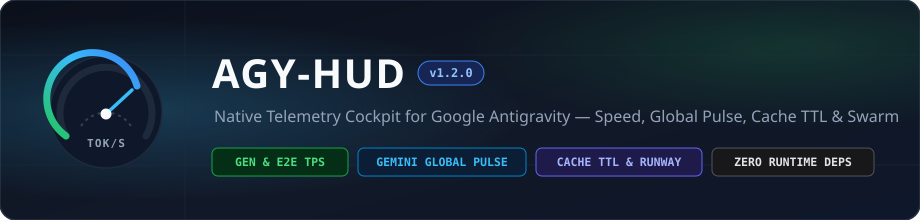
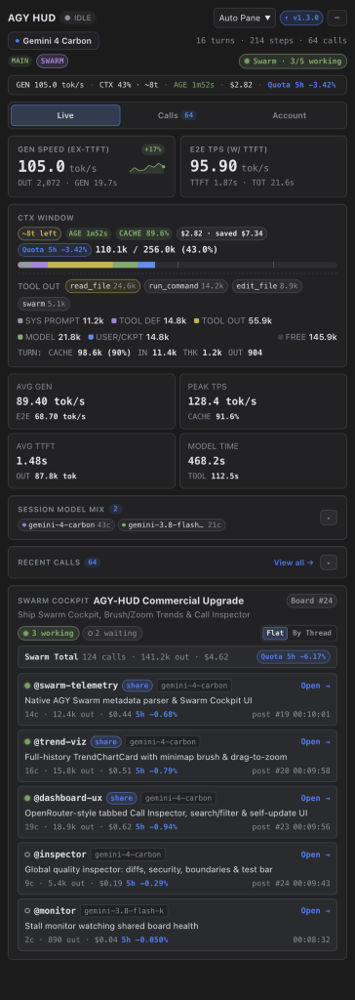
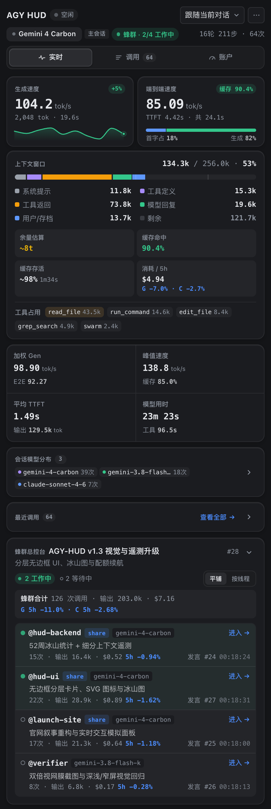
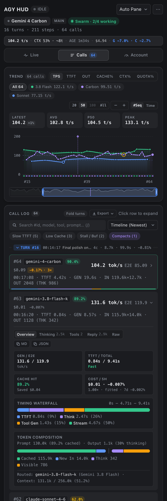
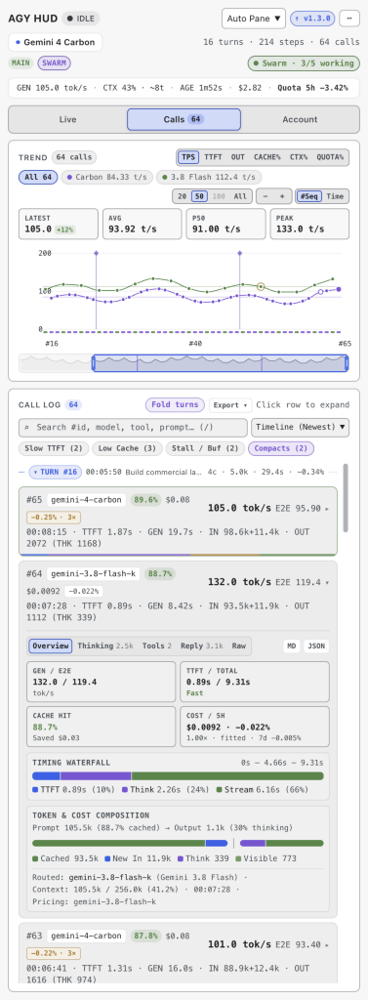
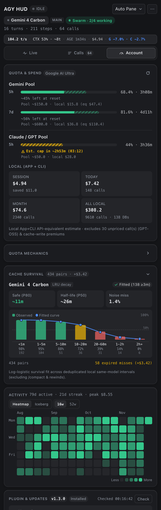

<div align="center">



<p>
  <strong>Mission control for Google Antigravity — real-time token throughput, TTFT waterfalls, routed model truth (<code>f19</code>), context X-ray, calibrated 5h/7d quota runway, and first-class native Swarm observability.</strong>
</p>

<p>
  <a href="LICENSE"></a>
  
  
  
  
</p>

<p>
  <strong>English</strong> ·
  <a href="README.zh-CN.md">简体中文</a> ·
  <a href="https://skywalker512.github.io/agy-hud/">Website</a> ·
  <a href="docs/INSTALLATION.md">Installation</a> ·
  <a href="docs/GUIDE.md">User &amp; Technical Guide</a> ·
  <a href="CHANGELOG.md">Changelog</a>
</p>

<p>
  <a href="#why-agy-hud">Why AGY-HUD</a> ·
  <a href="#visual-showcase">Showcase</a> ·
  <a href="#quick-install">Quick Install</a> ·
  <a href="#comparison">Comparison</a> ·
  <a href="#shortcuts">Shortcuts</a> ·
  <a href="#development">Development</a>
</p>

</div>

---

## <a id="why-agy-hud"></a>Why AGY-HUD?

**AGY-HUD** is a native side-pane telemetry cockpit built specifically for **Google Antigravity 2.0**. Instead of sitting behind a fragile MITM API proxy or scraping truncated logs, it reads Antigravity's local SQLite conversation stores (`~/.gemini/antigravity/conversations/<uuid>.db` + `-wal`), local loopback Language Server RPC, and on-disk Swarm metadata in **strictly read-only mode** with **zero runtime npm dependencies** and **0 ms proxy latency**.

### 6 Killer Differentiators

1. **First-Class Native AGY Swarm Cockpit *(Zero Competitors)***
   Directly parses Antigravity's on-disk swarm state (`swarm.json`, `members.json`, `plan.json`, `board.jsonl`) with mtime caching. Displays the swarm title & goal, live pulsing `@rosterName` worker states (`working` / `waiting` / `stopped` / `killed`), assigned task titles, optional thread grouping (`Flat | By Thread`), `share`/`branch` worktree badges, `Board #seq`, rolled-up cost & 5h/7d quota burn across coordinator + workers, and one-click coordinator↔worker navigation with breadcrumbs.
2. **Interactive Historical Trend Explorer**
   Browse your entire session history across 6 metrics (`TPS`, `TTFT`, `OUT`, `CACHE`, `CTX`, `QUOTA%`) — never locked to the last 32 calls. Features range presets (`20 | 50 | 100 | All`), a TradingView-style **Minimap Brush/Scrubber** with resize handles and track jump, **canvas drag-to-zoom**, modifier-wheel cursor zoom, smart **`Follow Live ⏭`** locking, dual `#Seq / Time` X-axis, 4-cell viewport summary strip (`LATEST + Δ`, `AVG`, `P95`, `PEAK`), `0 ms` pointer crosshair, cross-metric compaction markers, and click-to-inspect drill-down.
3. **OpenRouter-Style Tabbed Call Detail Inspector & Explorer**
   Expanding any call opens a structured 5-tab inspector (`Overview` · `Thinking` · `Tools` · `Reply` · `Raw`) featuring a 4-cell metric strip, proportional **Timing Waterfall** (`TTFT` / `Think` / `Tool Gen & TC-WAIT` / `Reply Stream`), and **Token & Cost Composition Bar** (prompt cache prefix vs new input, thinking vs visible output). Paired with instant Call Log search (`/`), anomaly filter chips (`Slow TTFT >3s`, `Low Cache <60%`, `Stall / Buf`, `Compacts`), metric sorting, and one-click **Markdown / JSON** report export.
4. **Zero-Proxy Read-Only Telemetry & Ground-Truth Routed Model (`f19`)**
   Uses Node.js 22.18+'s built-in `node:sqlite` (`?mode=ro`) to expose the exact backend routed model identifier (`gen_metadata.f1.f19`, e.g. `gemini-4-carbon`, `gemini-3.8-flash-k`) and real context window limit (`f9.f10.f4`), cutting through opaque UI aliases. Cleanly separates sustained `GEN TPS` from `E2E TPS` and isolates single-packet `BUF` spikes so averages never exceed peak speed.
5. **Empirical `k`-Multiplier Quota Calibration, 5h/7d Runway & 16-Week Heatmap**
   Fits per-model `k`-multipliers and 5h/7d credit tank capacities via Huber/Tukey IRLS + adaptive `6σ` MAD outlier rejection (plus regularized 3-param token ridge for Claude families), surfacing out-of-sample error bands, unattributed remote spend gaps, and burn-rate exhaustion ETAs. Automatically discovers and merges App, CLI (`agy`), ACP, and IDE sibling stores into unified spend accounting and a 16-week daily activity heatmap.
6. **Smart Heuristic Chinese Detection, Host Theme Sync & Safe Self-Upgrade**
   Automatically detects Chinese environments on first launch using weighted OS locale, region, timezone, input method, and user-font signals (with 7-day disk caching and zero false positives from macOS system fonts), while allowing instant manual `EN / 中文` toggling. Synchronizes Antigravity's `light`, `dark`, and `strong` contrast themes automatically, and ships with one-line cross-platform installers, `--doctor` diagnostics, and hardened in-app self-upgrade.

---

## <a id="visual-showcase"></a>Visual Showcase

> All screenshots below are captured directly from the live AGY-HUD side-pane UI.

### Live Tab — Speed Sparkline, Context X-Ray & Native Swarm Cockpit

<table>
  <tr>
    <td width="50%" align="center">
      
      <br />
      <sub><strong>Live Tab (EN · Dark)</strong> — Hero GEN TPS sparkline &amp; delta, 5-bucket Context Window X-Ray, KPIs, and Native AGY Swarm Cockpit (<code>@rosterName</code>, live states, tasks, <code>Board #seq</code>, rolled-up quota).</sub>
    </td>
    <td width="50%" align="center">
      
      <br />
      <sub><strong>Live Tab (中文 · Dark)</strong> — Automatic heuristic Chinese localization &amp; Native Swarm Cockpit with full bilingual parity.</sub>
    </td>
  </tr>
</table>

### Calls Tab — Historical Trend Explorer & OpenRouter-Style Call Inspector

<table>
  <tr>
    <td width="50%" align="center">
      
      <br />
      <sub><strong>Calls Tab (EN · Dark)</strong> — Full-history Trend Chart (<code>20|50|100|All</code>), Minimap Brush/Scrubber, 4-cell viewport stat strip, and expanded Call Detail Inspector (Timing Waterfall + Token Composition Bar).</sub>
    </td>
    <td width="50%" align="center">
      
      <br />
      <sub><strong>Calls Tab (EN · Light)</strong> — Automatic Antigravity Light Theme synchronization with high-contrast etched surfaces and Call Explorer.</sub>
    </td>
  </tr>
</table>

### Account Tab — Dual 5h/7d Runway, `k`-Multiplier Rules, Heatmap & Self-Update

<div align="center">
  
  <br />
  <sub><strong>Account Tab (EN · Dark)</strong> — Dual 5h/7d Quota Pool Runway, Calibrated <code>k</code>-Multiplier Rules, Multi-Store (App + CLI) Spend Grid, 16-Week Activity Heatmap, and 1-Click <strong>Plugin &amp; Updates</strong> card.</sub>
</div>

---

## <a id="quick-install"></a>Quick Install

**Requirement**: **Node.js 22.18+** (for built-in `node:sqlite` and native TypeScript execution) and **Google Antigravity 2.0**.

### macOS & Linux (One-Line Install)

```sh
curl -fsSL https://raw.githubusercontent.com/skywalker512/agy-hud/main/scripts/install.sh | sh
```

### Windows (PowerShell 5.1+ / PowerShell 7+)

```powershell
irm https://raw.githubusercontent.com/skywalker512/agy-hud/main/scripts/install.ps1 | iex
```

### Install from Source or Dev Symlink

```bash
git clone https://github.com/skywalker512/agy-hud.git
cd agy-hud

# Atomic copy-install into ~/.gemini/config/plugins/agy-hud
node plugin/install.mjs

# Or link directly for live development hot-reload (symlink on Unix, junction on Windows)
node plugin/install.mjs --link
```

### Verify, Update & Uninstall

```bash
# Run full environment & installation health diagnostics (6 checks)
node plugin/install.mjs --doctor

# Check for or apply updates from CLI (or click "Update Now" inside Account → Plugin & Updates)
node plugin/install.mjs --check-update
node plugin/install.mjs --update

# Remove the installed plugin or dev symlink cleanly
node plugin/install.mjs --uninstall
```

> Restart Antigravity (or reload plugins) after first installation if the AGY-HUD side-pane icon does not appear immediately. See [docs/INSTALLATION.md](docs/INSTALLATION.md) for custom target directories, pinned versions, `--json` output, and troubleshooting.

---

## <a id="comparison"></a>How AGY-HUD Compares

| Capability | **AGY-HUD** | **API Proxy Monitors** | **CLI Log Aggregators** | **Basic Statuslines** |
| :--- | :---: | :---: | :---: | :---: |
| **Zero-Proxy Local Read-Only Telemetry** | **Native `node:sqlite` + LS RPC** | MITM proxy required | Post-hoc log parse | Stdin / shell hooks |
| **First-Class Native AGY Swarm Cockpit** | **Full roster, states, tasks, threads, board `#seq`** | No | No | Count only |
| **Ground-Truth Routed Model ID (`f19`)** | **Yes (backend ID + real context cap)** | Request alias only | Alias only | Alias only |
| **GEN vs E2E TPS + `BUF` Spike Isolation** | **Yes (sustained + buffered split)** | Partial | No | No |
| **Historical Minimap Brush & Drag-to-Zoom** | **Full session + `Follow Live` + drill-down** | Web dashboard only | Static CLI tables | None |
| **OpenRouter-Style Call Waterfall & Export** | **5-tab inspector + MD / JSON export** | Web dashboard only | JSON / CSV tables | None |
| **Empirical `k`-Fitter & 5h/7d Runway** | **IRLS `k`, OOS error, remote gap, ETA** | No | Cost tables only | Raw % only |
| **Multi-Store (App + CLI) + 16-Week Heatmap** | **Auto-discovered & merged** | Proxy traffic only | Manual paths | Session only |
| **Runtime Dependencies / Proxy Overhead** | **0 deps · 0 ms** | Heavy runtime + latency | CLI runtime | Minimal |

---

## <a id="shortcuts"></a>Keyboard Shortcuts & Chart Controls

When the AGY-HUD side pane is focused (shortcuts automatically ignore text inputs and dropdowns):

| Shortcut / Gesture | Action |
| :--- | :--- |
| `1` / `2` / `3` | Switch between **Live**, **Calls**, and **Account** tabs |
| `/` | Focus the Call Log search box (auto-switches to **Calls** tab if needed) |
| `Esc` | Clear Call Log search, close `⋯` / Export popovers, or dismiss chart crosshair |
| **Drag horizontally** on Trend Chart | Draw a zoom marquee (`≥ 8 px`) to zoom straight into that historical range |
| **Click** a point/bar on Trend Chart | Jump directly to and expand that exact call in the Call Log (`< 6 px` move) |
| `Ctrl` / `Cmd` / `Shift` + **Mouse Wheel** | Smooth cursor-centered zoom (regular vertical scrolling is never hijacked) |
| **Horizontal trackpad swipe** (zoomed) | Pan smoothly left/right across history |
| **Minimap Brush** drag / handles / click / dbl-click | Pan viewport, resize window edges, click track to jump-center, double-click to reset to `All` / `Follow Live` |

---

## Documentation & Launch Site

- **Launch Website**: [skywalker512.github.io/agy-hud](https://skywalker512.github.io/agy-hud/) *(source in [`site/`](site/))*
- **Installation & Self-Upgrade Guide**: [docs/INSTALLATION.md](docs/INSTALLATION.md) · [中文安装文档](docs/INSTALLATION.zh-CN.md)
- **Complete User & Technical Guide**: [docs/GUIDE.md](docs/GUIDE.md) · [完整使用与技术指南](docs/GUIDE.zh-CN.md)
  - Native Swarm Observability Cockpit (`swarm.json` / `members.json` / `plan.json` / `board.jsonl`)
  - Historical Trend Explorer & OpenRouter-Style Call Inspector
  - Heuristic Chinese Detection & 7-Day Disk Cache
  - Metrics Glossary, Protobuf Field Map & Quota `k`-Fitter Math
- **Release History**: [CHANGELOG.md](CHANGELOG.md)

---

## <a id="development"></a>Development

The sidecar backend (`plugin/sidecars/hud_panel/`) runs directly on Node.js 22.18+ with zero runtime dependencies. The UI source lives in `web/` (Preact + TypeScript + Tailwind CSS v4) and compiles into `plugin/sidecars/hud_panel/ui/`:

```bash
# Install UI build dependencies and compile the bundle
npm --prefix web install
npm --prefix web run build      # typecheck + Vite build -> plugin/sidecars/hud_panel/ui/
npm --prefix web run dev        # watch mode (pair with `node plugin/install.mjs --link`)

# Run full verification: backend typecheck + UI build + all unit & trace tests
npm --prefix plugin/sidecars/hud_panel run check
```

Or run test suites directly:

```bash
node --test plugin/sidecars/hud_panel/test/*.test.ts
node --test tools/test/trace.test.mjs
```

### Project Structure

```text
agy-hud/
├── plugin/                      # Installed Antigravity 2.0 side-pane plugin
│   ├── plugin.json              # Plugin manifest
│   ├── install.mjs              # Cross-platform installer, updater & --doctor CLI
│   ├── assets/logo.svg          # Plugin icon
│   └── sidecars/hud_panel/      # Zero-dep Node 22.18+ backend (lib/, pricing.json) & built ui/
├── scripts/                     # One-line installers (install.sh for macOS/Linux, install.ps1 for Windows)
├── web/                         # Side-pane UI source (Preact + TypeScript + Tailwind v4)
├── site/                        # Commercial launch website (Vite + Preact + Tailwind v4)
├── tools/                       # Trace collector & replay CLI for regression fixtures
├── docs/                        # Detailed EN/ZH guides & real UI screenshots
├── CHANGELOG.md
└── LICENSE
```

---

## License

Released under the [MIT License](LICENSE).
