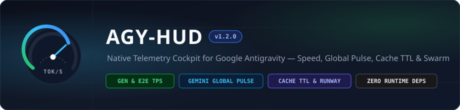
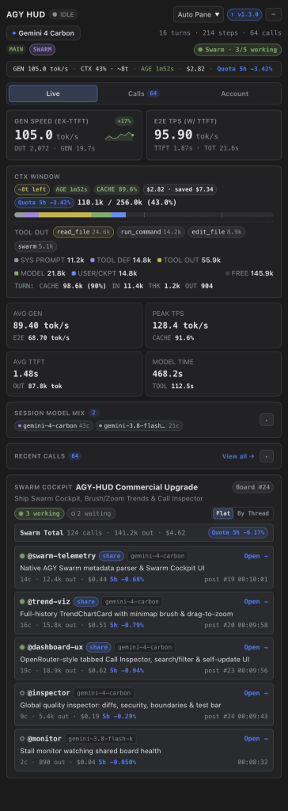
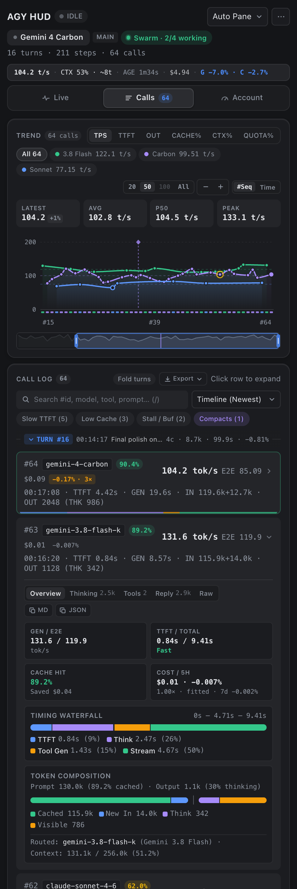
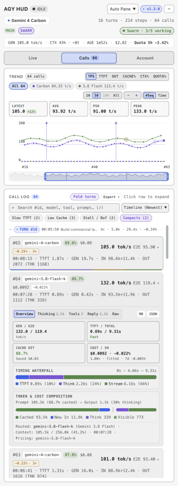
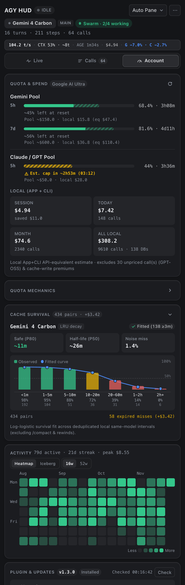

<div align="center">



<p>
  <strong>Google Antigravity 的实时遥测驾驶舱 —— 集生成吞吐率、首字延迟瀑布图、真实路由模型标识（<code>f19</code>）、上下文透视、5h/7d 配额续航校准与原生 Swarm 蜂群监控于一体。</strong>
</p>

<p>
  <a href="LICENSE"></a>
  
  
  
  
</p>

<p>
  <a href="README.md">English</a> ·
  <strong>简体中文</strong> ·
  <a href="https://skywalker512.github.io/agy-hud/">产品官网</a> ·
  <a href="docs/INSTALLATION.zh-CN.md">安装与升级</a> ·
  <a href="docs/GUIDE.zh-CN.md">完整使用与技术指南</a> ·
  <a href="CHANGELOG.md">更新日志</a>
</p>

<p>
  <a href="#why-agy-hud">核心优势</a> ·
  <a href="#visual-showcase">界面实拍</a> ·
  <a href="#quick-install">一键安装</a> ·
  <a href="#comparison">方案对比</a> ·
  <a href="#shortcuts">快捷键与交互</a> ·
  <a href="#development">本地开发</a>
</p>

</div>

---

## <a id="why-agy-hud"></a>为什么选择 AGY-HUD？

**AGY-HUD** 是一款专为 **Google Antigravity 2.0** 打造的原生侧边栏遥测插件。它不依赖任何中间人 API 代理，也不需要解析残缺日志，而是以**严格只读模式**直接读取本地 SQLite 对话库（`~/.gemini/antigravity/conversations/<uuid>.db` 与 `-wal`）、本机回环 Language Server RPC 及磁盘上的 Swarm 状态文件 —— **零运行时 npm 依赖**、**0 ms 代理延迟**、**100% 本地隐私安全**。

### 六大核心差异化能力

1. **原生 AGY Swarm 蜂群驾驶舱 *（独家首发）***
   直接读取 Antigravity 磁盘上的蜂群元数据（`swarm.json`、`members.json`、`plan.json`、`board.jsonl`），内置 `mtime` 缓存实现近零开销轮询。实时呈现蜂群标题与目标、`@rosterName` 成员状态脉冲（`working` / `waiting` / `stopped` / `killed`）、任务摘要、按线程分组切换（`平铺 | 按线程`）、`share`/`branch` 独立工作树徽章、公告板 `Board #seq`、协调者与全体工作节点汇总成本/配额消耗，以及主从会话一键互跳与面包屑导航。
2. **全历史时间序列浏览器与缩略图刷选器**
   打破“仅看最近 32 次调用”的限制，支持 6 大指标（`速度` / `首字` / `输出` / `缓存` / `上下文` / `配额%`）全会话历史自由回溯。提供快捷范围预设（`20 | 50 | 100 | 全部`）、TradingView 风格的**缩略图刷选条（Minimap Brush）**（支持左右手柄缩放、主体平移、轨道点击定位与双击重置）、**画布拖选缩放**、组合键滚轮以鼠标为中心缩放、智能 **`跟随最新 ⏭`** 锁定机制、双 X 轴模式（`#序号 / 时间`）、视口四格汇总条（`最新 + 差值` / `均值` / `P95` / `峰值`）、`0 ms` 十字准星、全指标压缩事件标线以及点击柱点直达调用详情。
3. **OpenRouter 风格多页签调用详情检视器**
   展开任意一条调用记录即可进入五页签结构化面板（`概览` · `思考` · `工具` · `回复` · `原始数据`），内置四格核心指标卡、按比例绘制的**分阶段耗时瀑布图**（`TTFT` / `思考` / `工具参数生成 & TC-WAIT` / `正文流式输出`）以及 **Token 与成本构成条**（缓存前缀占比与思考/可见输出拆分）。搭配调用日志即时搜索（`/`）、异常筛选胶囊（`慢首字 >3s`、`低缓存 <60%`、`卡顿/单包`、`仅压缩`）、按指标排序以及一键导出 **Markdown / JSON** 诊断报告。
4. **零代理只读遥测与真实后端路由模型标识（`f19`）**
   基于 Node.js 22.18+ 内置 `node:sqlite` 只读打开对话库，优先解码 `gen_metadata.f1.f19` 还原真实路由的后端模型（如 `gemini-4-carbon`、`gemini-3.8-flash-k`）与真实上下文上限（`f9.f10.f4`），穿透前端展示别名。严格区分首字后流式速率（`GEN TPS`）与端到端速率（`E2E TPS`），自动标记并剔除单包缓冲响应（`BUF`），杜绝均值高于峰值的统计失真。
5. **实测 `k` 倍率配额校准、5h/7d 耗尽预测与 16 周热力图**
   采用 Huber/Tukey IRLS 鲁棒回归与自适应 `6σ` MAD 异常值剔除（对 Claude 系列进一步启用三参数正则化 Token 岭回归），结合样本外验证自动拟合各模型配额倍率 `k` 与 5h/7d 信用池容量，给出未归因外部消耗差值与续航耗尽 ETA。自动发现并合并本机 App、CLI（`agy`）、ACP 与 IDE 多端历史库，统一汇总消费账单与近 16 周活跃度热力图。
6. **智能中文环境启发式识别、宿主主题同步与安全自升级**
   首次启动即综合系统语言、地区子标签、时区、中文输入法与用户自装中文字体进行加权评分（7 天持久化缓存，且将 macOS 预装 `PingFang.ttc` 权重归零以避免英文系统误判），同时保留随时手动切换 `EN / 中文`。自动跟随 Antigravity 浅色、深色与高对比度主题，并提供跨平台一键安装脚本、`--doctor` 健康诊断及严格白名单校验的应用内一键升级。

---

## <a id="visual-showcase"></a>界面实拍展示

> 以下截图均直接采集自最新构建的 AGY-HUD 侧边栏真实界面。

### 实时页签（Live）—— 吞吐折线、上下文透视与原生 Swarm 蜂群驾驶舱

<table>
  <tr>
    <td width="50%" align="center">
      
      <br />
      <sub><strong>实时页签（中文 · 深色）</strong> —— 自动中文启发式识别、GEN 速度迷你趋势线与环比增幅、五维上下文构成条及原生 AGY Swarm 蜂群驾驶舱。</sub>
    </td>
    <td width="50%" align="center">
      
      <br />
      <sub><strong>Live Tab（EN · Dark）</strong> —— 完整中英文双语对等展示，支持一键无刷新切换语言。</sub>
    </td>
  </tr>
</table>

### 调用页签（Calls）—— 全历史趋势浏览器与 OpenRouter 风格详情检视器

<table>
  <tr>
    <td width="50%" align="center">
      
      <br />
      <sub><strong>调用页签（深色）</strong> —— 全历史趋势图（<code>20|50|100|All</code>）、缩略图刷选条、视口四格汇总，以及展开后的分阶段耗时瀑布图与 Token 构成条。</sub>
    </td>
    <td width="50%" align="center">
      
      <br />
      <sub><strong>调用页签（浅色）</strong> —— 自动同步 Antigravity 浅色宿主主题，清晰的细线层级与调用检索工具栏。</sub>
    </td>
  </tr>
</table>

### 账户页签（Account）—— 双窗口配额续航、`k` 倍率规则、16 周热力图与自升级

<div align="center">
  
  <br />
  <sub><strong>账户页签（深色）</strong> —— 5h/7d 双配额窗口与续航倒计时、实测 <code>k</code> 倍率规则卡、多端消费网格、16 周每日活跃热力图以及<strong>插件与更新</strong>一键升级卡片。</sub>
</div>

---

## <a id="quick-install"></a>一键快速安装

**环境要求**：**Node.js 22.18+**（用于内置 `node:sqlite` 与原生 TypeScript 执行）及 **Google Antigravity 2.0**。

### macOS / Linux（单行命令安装）

```sh
curl -fsSL https://raw.githubusercontent.com/skywalker512/agy-hud/main/scripts/install.sh | sh
```

### Windows（PowerShell 5.1+ / PowerShell 7+）

```powershell
irm https://raw.githubusercontent.com/skywalker512/agy-hud/main/scripts/install.ps1 | iex
```

### 从源码安装或开发软链接模式

```bash
git clone https://github.com/skywalker512/agy-hud.git
cd agy-hud

# 原子暂存复制安装到 ~/.gemini/config/plugins/agy-hud
node plugin/install.mjs

# 或创建开发链接实现实时热重载（Unix 软链接 / Windows 目录联接 Junction）
node plugin/install.mjs --link
```

### 健康检查、升级与卸载

```bash
# 运行 6 项完整环境与安装健康检查
node plugin/install.mjs --doctor

# 命令行检查更新或直接升级（也可在插件“账户 → 插件与更新”卡片中一键升级）
node plugin/install.mjs --check-update
node plugin/install.mjs --update

# 干净卸载插件目录或开发软链接
node plugin/install.mjs --uninstall
```

> 首次安装后若侧边栏未立即出现 AGY-HUD 图标，重启 Antigravity 或重新加载插件即可。自定义安装路径、指定版本安装、`--json` 输出及排障说明请查阅 [docs/INSTALLATION.zh-CN.md](docs/INSTALLATION.zh-CN.md)。

---

## <a id="comparison"></a>方案对比

| 核心维度 | **AGY-HUD** | **API 代理类监控** | **CLI 日志统计工具** | **基础状态栏插件** |
| :--- | :---: | :---: | :---: | :---: |
| **零代理本地只读遥测** | **原生 `node:sqlite` + LS RPC** | 需配置 MITM 代理 | 事后扫描日志 | 仅标准输入/钩子 |
| **原生 AGY Swarm 蜂群驾驶舱** | **完整成员、状态、任务、线程与 `#seq`** | 无 | 无 | 仅子代理计数 |
| **真实后端路由模型标识（`f19`）** | **支持（含真实上下文上限）** | 仅请求别名 | 仅别名 | 仅别名 |
| **GEN / E2E 分离与 `BUF` 异常剔除** | **支持（持续流式与单包隔离）** | 部分支持 | 不支持 | 不支持 |
| **全历史缩略图刷选与拖选缩放** | **全会话导航 + 跟随最新 + 点击跳转** | 仅外部 Web 页 | 静态终端表格 | 无 |
| **OpenRouter 风格瀑布图与报告导出** | **5 页签检视器 + MD / JSON 导出** | 仅外部 Web 页 | 仅表格/JSON | 无 |
| **实测 `k` 倍率拟合与 5h/7d 续航** | **IRLS 拟合、OOS 误差、远程差值与 ETA** | 不支持 | 仅估算账单 | 仅原始百分比 |
| **多端（App + CLI）汇总与 16 周热力图** | **自动发现并合并** | 仅代理经过流量 | 需手动指定路径 | 仅单会话 |
| **运行时依赖 / 代理延迟** | **0 依赖 · 0 ms** | 重型服务 + 代理延迟 | 需 CLI 运行时 | 轻量 |

---

## <a id="shortcuts"></a>快捷键与图表交互

当焦点位于 AGY-HUD 侧边栏面板时（输入框与下拉框获得焦点时自动回避）：

| 快捷键 / 手势 | 功能说明 |
| :--- | :--- |
| `1` / `2` / `3` | 快速切换 **实时（Live）** / **调用（Calls）** / **账户（Account）** 页签 |
| `/` | 聚焦调用日志搜索框（若不在“调用”页签则自动切换过去） |
| `Esc` | 清空调用搜索词、关闭 `⋯` / 导出菜单，或取消图表悬停准星 |
| 在趋势图上**横向拖拽**（`≥ 8 px`） | 拉出选区框并立即放大至对应历史片段 |
| **单击**趋势图任意数据点 / 柱条（`< 6 px`） | 直接定位并展开调用日志中对应的那次调用并高亮闪烁 |
| `Ctrl` / `Cmd` / `Shift` + **鼠标滚轮** | 以光标位置为中心平滑缩放（绝不劫持正常纵向页面滚动） |
| 缩放状态下**触控板横向滑动** | 平滑左右平移历史视口 |
| **缩略图刷选条（Minimap Brush）** | 拖拽左右手柄调整窗口宽度、拖拽主体平移、点击空白轨道居中跳选、双击恢复 `全部` / `跟随最新` |

---

## 详细文档与产品官网

- **产品官网**：[skywalker512.github.io/agy-hud](https://skywalker512.github.io/agy-hud/) *（源码位于 [`site/`](site/)）*
- **安装、诊断与安全自升级指南**：[docs/INSTALLATION.zh-CN.md](docs/INSTALLATION.zh-CN.md) · [English](docs/INSTALLATION.md)
- **完整用户与技术指南**：[docs/GUIDE.zh-CN.md](docs/GUIDE.zh-CN.md) · [English](docs/GUIDE.md)
  - 原生 Swarm 蜂群观测驾驶舱（`swarm.json` / `members.json` / `plan.json` / `board.jsonl`）
  - 历史趋势浏览器与 OpenRouter 风格调用检视器
  - 启发式中文识别权重与 7 天磁盘缓存机制
  - 核心指标公式、Protobuf 字段映射与配额 `k` 倍率数学模型
- **版本更新日志**：[CHANGELOG.md](CHANGELOG.md)

---

## <a id="development"></a>本地开发

侧边栏后端位于 `plugin/sidecars/hud_panel/`，直接由 Node.js 22.18+ 运行，无需额外编译或运行时依赖。前端界面源码位于 `web/`（Preact + TypeScript + Tailwind CSS v4），构建产物输出至 `plugin/sidecars/hud_panel/ui/`：

```bash
# 安装前端开发依赖并构建界面产物
npm --prefix web install
npm --prefix web run build      # 类型检查 + Vite 构建 -> plugin/sidecars/hud_panel/ui/
npm --prefix web run dev        # 监听改动自动重建（配合 `node plugin/install.mjs --link`）

# 运行全套校验：后端类型检查 + 前端构建 + 全部单元与轨迹测试
npm --prefix plugin/sidecars/hud_panel run check
```

也可单独运行测试套件：

```bash
node --test plugin/sidecars/hud_panel/test/*.test.ts
node --test tools/test/trace.test.mjs
```

### 目录结构

```text
agy-hud/
├── plugin/                      # 实际安装的 Antigravity 2.0 侧边栏插件
│   ├── plugin.json              # 插件清单
│   ├── install.mjs              # 跨平台安装、升级与 --doctor 诊断脚本
│   ├── assets/logo.svg          # 插件图标
│   └── sidecars/hud_panel/      # 零依赖 Node 22.18+ 后端（lib/、pricing.json）与构建后 ui/
├── scripts/                     # 单行安装脚本（macOS/Linux install.sh、Windows install.ps1）
├── web/                         # 侧边栏界面源码（Preact + TypeScript + Tailwind v4）
├── site/                        # 产品官网源码（Vite + Preact + Tailwind v4）
├── tools/                       # 调用轨迹录制 / 回放 CLI（回归测试夹具工具）
├── docs/                        # 中英文详细文档与真实界面截图
├── CHANGELOG.md
└── LICENSE
```

---

## 开源协议

基于 [MIT License](LICENSE) 开源。
