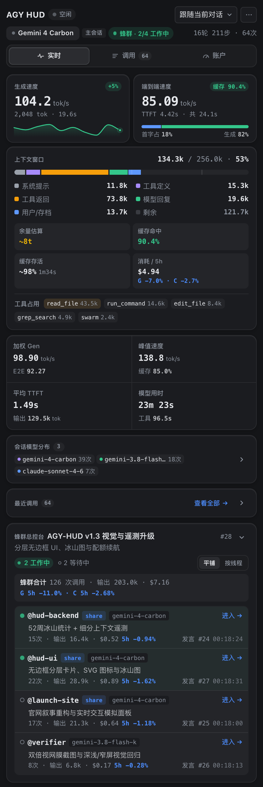

<div align="center">


<p>
  <strong>Google Antigravity 的原生侧边栏遥测面板 —— 实时生成速度、首字动态读秒监控、Gemini 全球 7d/5m 实时雷达与赛博斗蛐蛐、提示词缓存存活预测、实测配额续航、Swarm 递归汇总与 2x 战报海报，一眼看清。</strong>
</p>

<p>
  <a href="LICENSE"></a>
  
  
  
  
</p>

<p>
  <a href="README.md">English</a> ·
  <strong>简体中文</strong> ·
  <a href="https://agy-hud.512.pub/">产品官网</a> ·
  <a href="https://agy-hud.512.pub/pulse/">Gemini 实时雷达</a> ·
  <a href="#quick-install">10 秒安装</a> ·
  <a href="#interface-tour">一读就懂</a> ·
  <a href="docs/GUIDE.zh-CN.md">完整技术指南</a> ·
  <a href="AGENTS.md">AGENTS.md</a>
</p>

</div>

<table>
  <tr>
    <td width="50%" align="center">
      
      <br />
      <sub><strong>实时（Live）</strong> —— 持续流式速度与面积迷你图、双列上下文透视、缓存 TTL 存活预测与原生 Swarm 蜂群视图。</sub>
    </td>
    <td width="50%" align="center">
      
      <br />
      <sub><strong>调用（Calls）</strong> —— 全历史趋势图与缩略图刷选条、五页签详情检视器、耗时瀑布图与 Token 构成条。</sub>
    </td>
  </tr>
</table>

<table>
  <tr>
    <td width="33%" align="center">
      
      <br />
      <sub><strong>账户（Account）</strong> —— 斜纹 5h/7d 续航条、<code>k</code> 倍率规则、缓存 TTL 曲线、16w/52w 冰山热力图与一键升级。</sub>
    </td>
    <td width="33%" align="center">
      
      <br />
      <sub><strong>原生浅色同步</strong> —— 自动采样 Antigravity 主题色、字号缩放与高对比度模式，无缝融入宿主界面。</sub>
    </td>
    <td width="33%" align="center">
      
      <br />
      <sub><strong>中英双语对等</strong> —— 首次启动启发式识别语言，随时在菜单中一键无刷新切换。</sub>
    </td>
  </tr>
</table>

---

## <a id="quick-install"></a>10 秒快速安装

> **纯官方 Antigravity Sidecar 架构 · 无需 CDP 调试端口 · 不修改 `app.asar` · 100% 本地只读 · 零运行时依赖**

### macOS / Linux

```sh
curl -fsSL https://h.512.pub | sh
```

### Windows（PowerShell 5.1+ / 7+）

```powershell
irm https://h.512.pub | iex
```

<sub><code>h.512.pub</code> 会按客户端自动分发：<code>curl</code>/<code>wget</code> 返回 <a href="scripts/install.sh"><code>install.sh</code></a>，PowerShell 返回 <a href="scripts/install.ps1"><code>install.ps1</code></a>，浏览器访问自动跳转官网 <a href="https://agy-hud.512.pub/">agy-hud.512.pub</a>（也可在浏览器访问 <code>https://h.512.pub/sh</code> 或 <code>/ps1</code> 直接查看源码）。</sub>

### 一句话让 AI Agent 自动安装

直接把下面这句话发给 Antigravity、Claude Code、Codex 或任意编程助手（完整 Agent 指令见 [`AGENTS.md`](AGENTS.md)）：

> `请按照 https://github.com/skywalker512/agy-hud 仓库中的 AGENTS.md 安装 agy-hud 并验证安装结果。`

<details>
<summary><strong>官方 <code>agy plugin install</code>、CLI <code>/statusline</code>、开发热重载（<code>--link</code>）、健康诊断（<code>--doctor</code>）与卸载</strong></summary>

```bash
git clone https://github.com/skywalker512/agy-hud.git && cd agy-hud
agy plugin validate --strict ./plugin  # 按官方加载器严格校验 manifest、/agy-hud 技能与 sidecar
agy plugin install ./plugin            # 通过官方 Antigravity CLI 插件命令安装
# 或使用内置零依赖安装器：
node plugin/install.mjs                # 原子复制安装至 ~/.gemini/config/plugins/agy-hud
node plugin/install.mjs --statusline   # 一键配置 Antigravity CLI 终端 /statusline 状态栏
node plugin/install.mjs --link         # 开发链接模式（macOS/Linux 软链接，Windows 目录联接）
node plugin/install.mjs --doctor       # 运行 6 项环境与插件健康检查
node plugin/install.mjs --update       # 命令行安全升级（失败自动回滚）
node plugin/install.mjs --uninstall-statusline
node plugin/install.mjs --uninstall
```

</details>

*环境要求：**Node.js 22.18+**（内置 `node:sqlite`）与 **Google Antigravity 2.0**。首次安装后若侧边栏未立即出现图标，重启 Antigravity 或重载插件即可。自定义路径、指定版本及排障请查阅 [docs/INSTALLATION.zh-CN.md](docs/INSTALLATION.zh-CN.md)。*

---

## <a id="interface-tour"></a>界面导览 · 一读就懂

围绕 Antigravity 窄侧边栏精心排布，三个页签各自回答一个核心问题：

### 1. 实时（Live）—— *这一轮现在跑得怎么样？*
- **主速度卡片与面积迷你折线**：清晰区分首字后流式速率（`GEN TPS`）与端到端速率（`E2E TPS`），附相对会话均值涨跌徽章与贴底平滑迷你面积图，自动剔除单包毛刺干扰。
- **上下文窗口透视**：带分段间隙的进度条支持悬停高亮联动下方**双列对齐明细表**（`系统提示`、`工具定义`、`工具返回`含单工具占用排行、`模型回复`、`用户 / 检查点`，并在可解析时细分 MCP / Skills / Rules）。
- **提前预判压缩与缓存失效**：底部紧凑四格微指标条一眼给出**剩余可用轮次（`~Nt`）**、**缓存命中率**、实时**提示词缓存 TTL 存活概率**与**本场费用 / `5h` 配额消耗**。
- **原生 AGY Swarm 蜂群驾驶舱与递归树汇总**：进入 Swarm 或多级子代理会话时自动浮现，集中呈现 `@rosterName` 实时状态、分配任务、`Board #seq`、主会话+全量后代节点递归费用/输出/配额汇总，以及协调者↔工作节点一键互跳。

### 2. 调用（Calls）—— *刚才那次为什么变慢或变贵了？*
- **会话 & 全球双模趋势浏览器**：支持全历史 6 大指标（`速度` / `首字` / `输出` / `缓存` / `上下文` / `配额%`，含缩略图刷选、拖选缩放、`跟随最新`），并可一键切至 **Global 全局趋势**，直接叠加 OpenRouter 7d/5m Gemini 全球大盘曲线（含 Vertex / AI Studio 拆分）与本机曲线同图对比。
- **五页签调用详情检视器**：展开任意一行即可切换 `概览`（四格核心条、按比例绘制的 `TTFT / 思考 / 工具生成 & TC-WAIT / 正文流式` **耗时瀑布图**与 **Token 构成条**）、`思考`、`工具`、`回复`、`原始数据`。
- **检索、筛选与报告导出**：按 `/` 即时搜索模型、提示词与工具名；通过异常胶囊快速过滤 `慢首字 >3s`、`低缓存 <60%`、`卡顿/单包`、`压缩`；支持按最慢/最贵排序，并一键复制 **Markdown / JSON** 诊断报告。

### 3. 账户（Account）—— *我的配额还能撑多久？*
- **Gemini 全局大盘、本机 vs 全球对比与 ⚔ 赛博斗蛐蛐 PK**：对照全球 30m/24h/7d 大盘（同步提供独立公开雷达站 [`agy-hud.512.pub/pulse/`](https://agy-hud.512.pub/pulse/)）实时评估本机首字、吞吐与缓存命中，结合上下文分桶延迟提示与 GCP 服务故障动态一眼识别快慢差异，并支持模型间 1v1 赛博斗蛐蛐 PK。
- **5h / 7d 双窗口斜纹续航条与实测 `k` 倍率**：在配额进度条内用斜纹区标出重置前预计消耗，并展示实测拟合的模型家族 `k` 倍率以及 7 分桶提示词缓存 TTL 生存曲线（`P80` / `P50` 安全窗口与过期重算成本）。
- **多端统一账单、16w/52w 冰山热力图与 2x 战报海报**：自动合并 App、CLI（`agy`）、ACP 与 IDE 历史账单，提供 **16 周 / 52 周活跃热力图**、**单色 Token 冰山图**、一键生成 **2x 高清 PNG Wrapped 战报海报**（赛博 / 流金 / 浅色三套主题），以及应用内安全一键升级。

---

## <a id="craftsmanship"></a>打磨细节

- **原生宿主主题、字号与高对比度同步** —— [`useThemeSync.ts`](web/src/hooks/useThemeSync.ts) 通过 `MutationObserver` 与宿主 `theme-change` 事件动态采样 Antigravity 的 CSS 变量（`--background`、`--card`、`--primary`）、字体族、字号缩放与强对比度状态。配合去边框化多层卡片、自绘统一 SVG 图标、定制弹出选择器，以及在 `Live` 顶部自动隐藏、滚过主速度卡后平滑浮现的智能 `PulseBar`，让面板真正像原生界面的一部分。
- **提示词缓存 TTL 生存建模** —— [`cache-ttl.ts`](plugin/sidecars/hud_panel/lib/cache-ttl.ts) 按模型家族拟合正则化 Log-Logistic 生存曲线 $S(t) = (1 - p_0) / (1 + (t / t_{50})^k)$（精准刻画 Claude 的硬 TTL 断崖与 Gemini 的平滑 LRU 衰减），输出 `P80` / `P50` 安全间隔、当前会话实时缓存存活率，以及一旦失效的美元与 `5h` 配额惩罚估算。
- **配额续航预测与实测 IRLS 校准** —— 基于干净短窗口（`≤ 15 分钟`）采用 Huber/Tukey IRLS 鲁棒回归与自适应 `6σ` MAD 异常值剔除，拟合模型 `k` 倍率与 Claude 三参数 Token 岭回归权重；长窗口单独用于估算跨设备远程消耗差值，并在样本外误差（`OOS`）达标前保持诚实的 `预估` 标注。
- **高保真本地只读遥测** —— 使用 Node.js 内置 `node:sqlite`（`?mode=ro`）直接解码本地 SQLite + WAL 中的 Protobuf `gen_metadata.f1.f19` 还原真实后端路由模型与真实上下文上限（`f9.f10.f4`），隔离单包 `BUF` 突刺使 `AVG GEN` 绝不虚高，拆分 `思考` 与 `TC-WAIT` 工具生成卡顿，并自动合并 App + CLI（`agy`）+ ACP + IDE 多端数据。
- **原生 AGY Swarm 蜂群驾驶舱** —— 只读解析 Antigravity 磁盘原生蜂群文件（`swarm.json`、`members.json`、`plan.json` 及有界读取的 `board.jsonl`）并做联合 `mtime` 缓存，提供实时脉冲状态、任务摘要、`平铺 | 按线程` 切换、`share`/`branch` 工作树徽章、公告板 `#seq`、全群费用与配额汇总，以及工作节点反向面包屑导航。
- **账户洞察、智能语言识别与安全自升级** —— 16w/52w 活跃热力图与单色 Token 冰山图清晰呈现缓存复用效率；首次启动多信号启发式识别中文环境（对 macOS 预装 `PingFang.ttc` 显式零权重，避免英文环境误判）；内置一键自升级严格执行 GitHub HTTPS 白名单、zip-slip 校验、SHA-256 后端变更检测与原子替换回滚。
- **Antigravity CLI `/statusline` 与内置 `/agy-hud` 只读技能** —— 内置零依赖终端状态栏适配器（[`statusline.ts`](plugin/sidecars/hud_panel/statusline.ts)），对接 Antigravity CLI 官方 `/statusline` JSON 协议并叠加实时 `GEN TPS`、`TTFT`、上下文余量与缓存 TTL 存活率（支持 `--two-line` 与 `--stack`）；同时打包只读 [`/agy-hud`](plugin/skills/agy-hud/SKILL.md) 技能，让插件推荐提示词与对话内遥测诊断完整闭环。

---

## <a id="shortcuts"></a>快捷键与图表手势

| 快捷键 / 手势 | 功能说明 |
| :--- | :--- |
| `1` / `2` / `3` | 切换 **实时（Live）** / **调用（Calls）** / **账户（Account）** 页签 |
| `/` | 聚焦调用日志搜索框（自动切换至 **调用** 页签） |
| `Esc` | 清空搜索词、关闭弹出菜单或取消图表十字准星 |
| 在趋势图上**横向拖拽**（`≥ 8 px`） | 拉框放大选定的历史区间 |
| **单击**趋势图数据点 / 柱条 | 直接定位并展开下方调用日志中的对应调用 |
| `Ctrl` / `Cmd` / `Shift` + **滚轮** | 以光标为中心平滑缩放（不劫持正常页面纵向滚动） |
| **缩略图刷选条（Minimap Brush）** | 拖手柄改跨度、拖主体平移、点轨道居中跳选、双击重置 |

---

## 隐私、架构与常见问题

- **100% 本地只读遥测**：只读取 `~/.gemini/antigravity/conversations/<uuid>.db`（`?mode=ro`）、本机回环 Language Server RPC 与本地 Swarm 元数据，任何提示词、代码与本地遥测都不会离开本机；外部请求仅限于只读拉取公开信息（GitHub 版本更新检查与可开关的 Gemini 全局大盘公共状态）。
- **零侵入、无惧宿主升级**：纯官方 Sidecar 插件，不修改 `app.asar`，也不需要给 Antigravity 附加 CDP 调试参数；直接点击日常应用图标启动，Antigravity 升级后依然开箱即用。
- **为什么需要 Node.js 22.18+？** 依赖内置 `node:sqlite` 与原生 TypeScript 类型剥离，从而让整个后端与安装脚本保持**零运行时 npm 依赖**。

---

## 详细文档与本地开发

| 文档 | 说明 |
| :--- | :--- |
| [产品官网](https://agy-hud.512.pub/) | 交互式三页签 HUD 演示、16 套主题同步与系统自适应安装引导（[`site/`](site/)） |
| [Gemini 实时雷达](https://agy-hud.512.pub/pulse/) | 5 分钟粒度公开 Gemini 全球首字、速度、缓存与 GCP 故障看板（[`workers/gemini-pulse/`](workers/gemini-pulse/)） |
| [安装与自升级指南](docs/INSTALLATION.zh-CN.md) | 自定义路径、指定版本、`--doctor` 诊断、安全模型与排障（[English](docs/INSTALLATION.md)） |
| [完整使用与技术指南](docs/GUIDE.zh-CN.md) | Swarm 驾驶舱、Gemini 大盘、缓存 TTL 数学模型、IRLS `k` 拟合、Protobuf 映射与接口文档（[English](docs/GUIDE.md)） |
| [AGENTS.md](AGENTS.md) | 面向 AI 编程助手的标准安装与验证指南 |
| [CHANGELOG.md](CHANGELOG.md) | 完整版本更新日志 |

<details>
<summary><strong>本地开发与测试命令</strong></summary>

```bash
# 构建前端界面产物（Preact + TypeScript + Tailwind CSS v4 -> plugin/sidecars/hud_panel/ui/）
npm --prefix web install
npm run build:ui
npm --prefix web run dev          # 监听改动自动重建（配合 `node plugin/install.mjs --link`）

# 运行全套校验：web/site/worker 类型检查 + sidecar / worker / tools 全部单元测试
npm run check
npm run build:site
```

</details>

---

## 致谢与参考项目

AGY-HUD 的诞生与演进离不开 Antigravity 开源社区的启发与共建，特别致谢以下项目：

- **[adahime/agy-hud](https://github.com/adahime/agy-hud)**（[@adahime](https://github.com/adahime)）—— 上游 Fork 源项目，开创了本地只读 SQLite/WAL Protobuf（`f19` / `gen_metadata`）遥测方案与初代 Antigravity 2.0 侧边栏插件底座。
- **[ATtacK030130/antigrative-dashboard](https://github.com/ATtacK030130/antigrative-dashboard)** —— 启发了我们的斜纹配额续航进度条（Quota Runway）、单色 Token 冰山图（Iceberg）与极简克制的视觉设计。
- **[yuhuan-dev/antigravity-usage-monitor](https://github.com/yuhuan-dev/antigravity-usage-monitor)** —— 启发了我们的无边框明度分层卡片、双列对齐上下文构成表与紧凑侧边栏导航。
- **[WhiteBr1ck/agy-powertools](https://github.com/WhiteBr1ck/agy-powertools)** —— 启发了我们的 Hero 底部通栏渐变曲线与无描边柔和热力图设计。
- **[AGI-is-going-to-arrive/Antigravity-Context-Window-Monitor](https://github.com/AGI-is-going-to-arrive/Antigravity-Context-Window-Monitor)** —— 启发了我们的 `AGENTS.md` 一句话 AI 助手自动安装体验。

基于 [MIT License](LICENSE) 开源。
