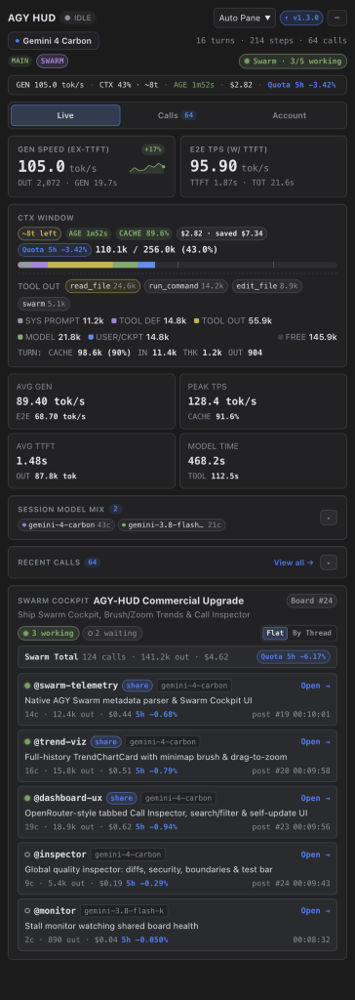
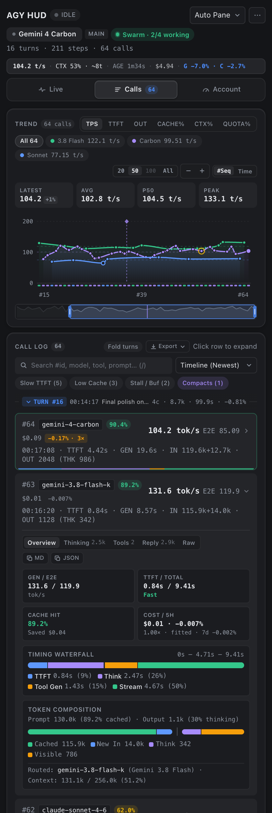
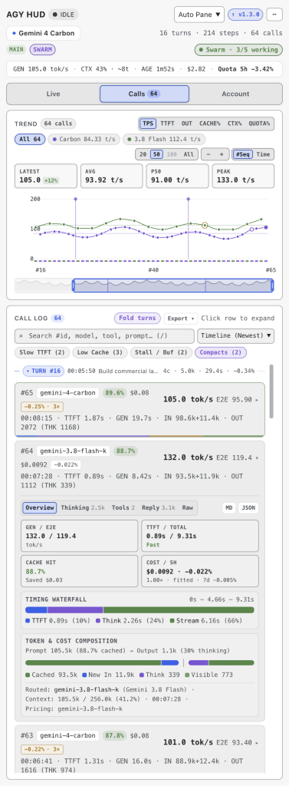
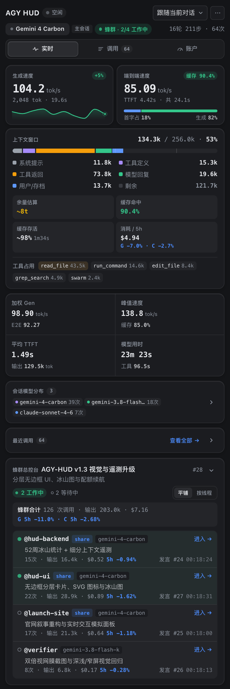
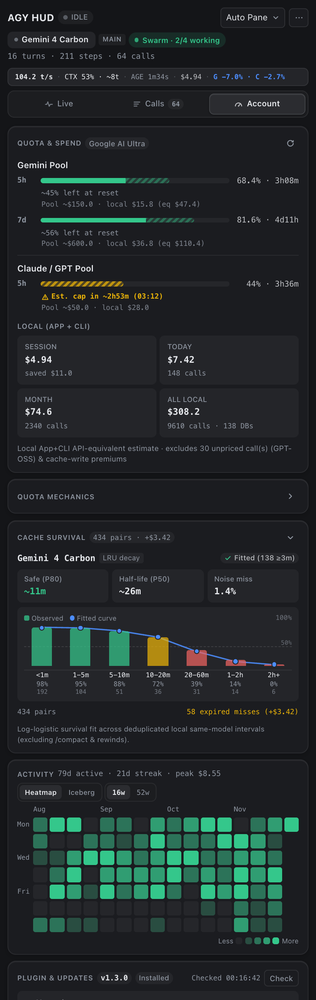

# AGY-HUD User & Technical Guide

> **English** · [简体中文](GUIDE.zh-CN.md) · [Back to README](../README.md) · [Installation Guide](INSTALLATION.md)

A complete operational and technical reference for every feature, formula, data source, and shortcut inside **AGY-HUD**.

---

## Table of Contents

1. [Native AGY Swarm Observability Cockpit](#1-native-agy-swarm-observability-cockpit)
2. [Historical Trend Explorer & Minimap Brush/Zoom](#2-historical-trend-explorer--minimap-brushzoom)
3. [OpenRouter-Style Call Inspector, Search & Export](#3-openrouter-style-call-inspector-search--export)
4. [Live Tab Diagnostics & Session Model Mix](#4-live-tab-diagnostics--session-model-mix)
5. [Heuristic Chinese Detection & Caching](#5-heuristic-chinese-detection--caching)
6. [Metrics Glossary & Protobuf Field Map](#6-metrics-glossary--protobuf-field-map)
7. [Empirical Quota `k`-Fitter & 5h/7d Runway Math](#7-empirical-quota-k-fitter--5h7d-runway-math)
8. [Keyboard Shortcuts & Sidecar API Reference](#8-keyboard-shortcuts--sidecar-api-reference)

---

## 1. Native AGY Swarm Observability Cockpit

<div align="center">
  
  <br />
  <sub>Live Tab featuring the Native AGY Swarm Cockpit with live pulsing states, <code>@rosterName</code> badges, task titles, <code>Board #seq</code>, and rolled-up swarm burn.</sub>
</div>

### How Swarm Discovery Works (`lib/swarm.ts`)

AGY-HUD monitors Antigravity's native on-disk swarm directory in **strictly read-only mode** across all discovered `appDataDir` roots:

```text
<appDataDir>/brain/<coordinator_conv_id>/.system_generated/swarm/
├── swarm.json      # { version, backend, swarm_id, created_at }
├── members.json    # { title, members: { "<rosterName>": { conversation_id, role, phase, desired_state, wake_mode, killed, applied_model, workspace_mode, last_read_seq } } }
├── plan.json       # { goal: { title, line }, tasks: { "<rosterName>": "..." }, threads: [{ id, title, goal, tasks }] }
└── board.jsonl     # Append-only JSONL { seq, agent, text, time, kind }
```

- **Near-Zero Overhead Caching**: Each swarm directory is cached by a combined `mtimeMs:size` signature across all 4 files (`swarm.json | members.json | plan.json | board.jsonl`), and `brain/` listings are cached by directory `mtimeMs`.
- **Bounded Board Reads**: For large `board.jsonl` logs, AGY-HUD reads only the trailing **64 KB** tail to extract the latest `boardSeq` and each agent's most recent post snippet (`120` chars) — plus a bounded **32 KB** head scan only when `plan.json` is missing task descriptions for a worker.
- **Reverse-Lookup Index**: Every worker `conversation_id` is indexed back to its coordinator (`workerConvId -> { coordinatorConvId, rosterName, swarm, member }`). Even when SQLite `parent_references` has not yet flushed, workers stay linked to their coordinator.

### Worker State Derivation

| Live Indicator | State | Derivation Rule (`members.json`) |
| :---: | :--- | :--- |
| Pulsing green dot | **`working`** | Not killed, `phase === 'RUNNING'` (or `desired_state === 'RUNNING'`), and `wake_mode === 'working'` |
| Hollow muted ring | **`waiting`** | Running, parked/asleep on the board (`wake_mode !== 'working'`) |
| Amber square | **`stopped`** | `phase === 'STOPPED'` or neither `phase` nor `desired_state` is `'RUNNING'` |
| `×` + strikethrough | **`killed`** | `killed === true` or `phase`/`desired_state === 'KILLED'` |

### Cockpit Features

- **Swarm Header & Rollup**: Displays the swarm title, `plan.json` goal subtitle, live active/waiting/stopped/killed counters, `Board #seq` badge, and rolled-up **calls, output tokens, USD cost, and 5h/7d quota burn** across the coordinator plus all workers.
- **Rich Member Cards**: Sorted **Active First** (`working → waiting → stopped → killed`, tie-broken by latest activity timestamp). Each card shows `@rosterName`, worktree badge (`share` / `branch` highlighted), routed model pill, clamped `taskTitle` (falling back to the worker's brief), tabular metrics, last board `#seq`, and a rich hover tooltip with latest board post snippet and read progress (`lastReadSeq / boardSeq`).
- **Thread Grouping**: Swarms with multiple `plan.json` threads automatically expose a **`Flat | By Thread`** toggle with collapsible thread sections.
- **Worker-View Breadcrumbs (`SessionRelBar` & Conversation Switcher)**: Jumping into any worker updates the top bar with `← @coordinator · <Swarm Title>` plus the active `@rosterName` and live state pill, and labels conversations as `[Swarm @rosterName]` in the top dropdown.

---

## 2. Historical Trend Explorer & Minimap Brush/Zoom

<div align="center">
  
  <br />
  <sub>Calls Tab showing the full-history Trend Chart, interactive Minimap Brush, 4-cell viewport stat strip, and expanded OpenRouter-style Call Detail Inspector.</sub>
</div>

The **Trend Chart** (`TrendChartCard.tsx`) provides full-session historical visibility across 6 metrics without external charting libraries:

### Supported Metrics & Visual Overlays

| Metric | Plot Style | Visual Overlays | Viewport 4-Cell Stat Strip |
| :--- | :--- | :--- | :--- |
| **`TPS`** | Monotone cubic curve + gradient area | 5-call EMA dashed trendline (`n ≥ 6`); hollow ring for `BUF`; amber ring for `TC-WAIT` stall | `LATEST + Δ%` · `AVG` (sustained) · `P50` · `PEAK` |
| **`TTFT`** | Monotone cubic curve + area | `3s` / `10s` SLA reference lines; right-labeled `P95` hairline; tier-colored markers | `LATEST + Δ%` · `AVG` · `P95` · `MAX` |
| **`OUT`** | Stacked rounded bars (`thinking` violet over `visible` green) | 5-call EMA polyline | `LATEST` · `AVG` · `THK%` · `SUM` |
| **`CACHE`** | Monotone cubic curve + area | `80%` target dashed line; crimson markers for `< 40%` | `LATEST + Δpp` · `AVG` · `MIN` · `≥80%` count |
| **`CTX`** | Monotone cubic curve + area | `80%–100%` shaded danger zone + compaction diamonds | `LATEST` · `HEADROOM (~Nt)` · `PEAK` · `COMPACTS` |
| **`QUOTA%`** | Rounded bars (amber highlight when `k ≥ 1.8×`) | Viewport mean line | `LATEST` · `AVG` · `PEAK` · `SUM` |

- **Cross-Metric Compaction Lines**: Context compaction events appear as vertical dashed purple lines with top diamonds across **all 6 metrics**, making post-compaction cache drops or TTFT shifts immediately obvious.
- **Nice Y-Axis Ticks**: Fixed `0 / 50 / 100%` for `CACHE` and `CTX`; human-rounded `1 / 2 / 2.5 / 5 × 10^k` ceilings for `TPS`, `TTFT`, `OUT`, and `QUOTA%`.

### Fast Historical Navigation Controls

1. **Range Presets (`20 | 50 | 100 | All`)**: Persisted in `localStorage`; automatically selects `50` on large sessions or `All` on smaller ones.
2. **Interactive Minimap Brush** *(rendered when filtered calls `> 8`)*:
   - Displays the entire session silhouette plus compaction ticks beneath the X-axis.
   - **Drag left/right handles** to resize the viewport (`minSpan = 4`).
   - **Drag viewport body** to pan left/right; dragging to the right edge automatically re-engages `Follow Live`.
   - **Click anywhere on the dimmed track** to jump-center the window there immediately.
   - **Double-click** the minimap to reset to `All` + `Follow Live`.
3. **Canvas Drag-to-Zoom & Wheel/Button Controls**:
   - **Drag horizontally (`≥ 8 px`)** across the main SVG plot to draw an accent zoom marquee.
   - **Click (`< 6 px` movement)** on any point/bar to drill down directly into that call in the Call Log.
   - **`Ctrl` / `Cmd` / `Shift` + Mouse Wheel**: Cursor-anchored zoom (regular vertical scrolling is never intercepted).
   - **Horizontal trackpad swipe** (while zoomed in): Smooth left/right pan.
   - **`[-]` / `[+]` micro-buttons** and **`#Seq` / `Time` X-axis toggle** (uniform call slots vs proportional `timestampMs` spacing).
4. **Smart `Follow Live ⏭` State Machine**:
   - Pinned to the latest calls by default so streaming invocations smoothly slide forward.
   - The moment you pan, brush, or drag-zoom into earlier history, `Follow Live` pauses and displays `Viewing #A–#B of N · [Follow Live ⏭]`, preventing incoming calls from hijacking your inspection window.
5. **Zero-Lag Crosshair**: Single pointer handler (`0 ms` delay) with vertical + horizontal guides, active halo, and an in-card structured popover showing `#idx`, routed model, timestamp, anomaly badges, primary value + delta, and a 2×2 companion metric grid.

---

## 3. OpenRouter-Style Call Inspector, Search & Export

### Collapsed Row & 2px Latency Hairline

Every collapsed invocation row displays `#idx`, routed model tag, cache-hit pill, anomaly micro-pills (`BUF`, `TC-WAIT`, `T#N` in flat views), USD cost, `-quota%` pill (with `~` for provisional estimates and `· 3×` badge for high-multiplier models), `GEN tok/s`, and `E2E tok/s`. A subtle **2px bottom-edge latency hairline** encodes `TTFT` (blue), `Thinking` (violet), `Tool Gen` (amber), and `Reply Stream` (emerald) proportions so high-TTFT calls stand out while scanning.

### Expanded 5-Tab Call Inspector (`InvocationRow.tsx`)

Clicking a row renders `Overview` instantaneously while lazily fetching full text & tool payloads via `/api/call-detail` (`60,000`-char cap):

1. **`Overview` *(default)***:
   - **4-Cell Summary Metric Strip**: `GEN / E2E`, `TTFT / TOTAL` (with tier color), `CACHE HIT` (with `$ saved`), and `COST / QUOTA` (`5h`/`7d`, `k×`, fitted vs provisional).
   - **Proportional Timing Waterfall**: Visualizes `TTFT Wait`, `Thinking`, `Tool Gen / TC-WAIT` (striped warning highlight when stalled), and `Reply Stream` (or unified `Generation`) with `3%` minimum visible segment widths and an inline `sec (%)` legend.
   - **Token & Cost Composition Bar**: Left bar splits Prompt tokens into `Cached` vs `New Input`; right bar splits Output tokens into `Thinking` vs `Visible`. Footer displays routed `modelId`, UI `modelDisplay`, exact `totalContext / contextLimit (%)`, and timestamp.
2. **`Thinking`**: Scrollable reasoning trace with char count and `[Copy]` button.
3. **`Tools`**: Structured tool-call cards showing tool name pill, pretty-printed JSON arguments (with raw fallback), and per-tool `[Copy Args]`.
4. **`Reply`**: Scrollable response text with `[Copy]`.
5. **`Raw`**: Pretty JSON view of the invocation telemetry + cached detail, with `[MD]` and `[JSON]` copy actions right in the tab bar.

### Call Explorer Toolbar & Diagnostic Export (`CallLogCard.tsx`)

Available in the full **Calls** tab:

- **Instant Search (`/` shortcut)**: Matches `#idx`, routed `modelId`, UI `modelDisplay`, user turn prompt preview, tool names, and cached thinking/reply text.
- **Sort Modes**: `Timeline (Newest)` *(preserves turn grouping)*, `Slowest Total`, `Highest TTFT`, `Lowest GEN TPS`, and `Highest Cost / Quota` *(switches to flat ranked rows with `T#N` turn pills)*.
- **Anomaly & Synced Model Chips** *(zero-count chips stay hidden)*:
  - `Slow TTFT (>3s)` · `Low Cache (<60%)` · `Stall / Buf` · `Compacts (N)`
  - Synced `Model` pill shared directly with the Trend Chart above.
- **Chart-to-Log Drill-Down**: Clicking any point/bar in the Trend Chart unfolds the call's turn, expands the row, scrolls smoothly to `[data-inv-idx]`, and plays a 1.2s accent ring highlight.
- **One-Click Exports (`web/src/utils/exportReport.ts`)**:
  - **Per-Call (`[MD]` / `[JSON]`)**: Copies a GitHub-flavored Markdown trace card or structured JSON payload.
  - **Session-Level (`⋯` TopBar menu & Call Log `[Export]`)**:
    - `Copy Session Report (MD)`: Executive summary with routed model mix table, P50/P95 TTFT, avg/peak GEN TPS, context trajectory, quota burn, top slowest/costliest calls, and compaction log.
    - `Export Telemetry (JSON)`: Downloads `agy-hud-<shortId>.json` (automatically falling back to clipboard copy if the host webview blocks file downloads).

---

## 4. Live Tab Diagnostics & Session Model Mix

- **Hero Speed Cards (`HeroSpeedCards.tsx`)**: Displays live `GEN TPS` and `E2E TPS`, a **session-average `%` delta badge**, and an **8-call inline GEN sparkline** (`≥ 3` calls).
- **Context Window X-Ray (`ContextWindowCard.tsx`)**: Breaks down active prompt tokens into 5 buckets — `Sys Prompt`, `Tool Defs`, `Tool Results` (with per-tool token footprint leaderboard), `Model Replies`, and `User / Ckpt` — plus median-delta **headroom turns** (`~Nt` remaining before compaction) and **prompt cache age**.
- **Conditional Session Model Mix (`LiveTab.tsx`)**: Whenever **2 or more routed models** appear in the same session (e.g. `gemini-4-carbon` + `gemini-3.8-flash-k`), a compact collapsible Model Mix card appears comparing each model's call count, sustained `AVG GEN`, `AVG TTFT`, `Cache %`, USD spend, and `5h` quota burn.
- **Host Theme Sync (`useThemeSync.ts`)**: Automatically inherits Antigravity's `light`, `dark`, and `strong` contrast variables and font scale.

<div align="center">
  
  <br />
  <sub>Automatic Antigravity Light Theme synchronization with etched hairline borders and high-contrast semantic tokens.</sub>
</div>

---

## 5. Heuristic Chinese Detection & Caching

<div align="center">
  
  <br />
  <sub>Automatic Chinese UI activation driven by multi-signal OS/locale heuristic scoring.</sub>
</div>

On first launch (when the user has not explicitly picked a language in `localStorage`), AGY-HUD calls `GET /api/locale`, powered by `plugin/sidecars/hud_panel/lib/locale.ts`.

### Scoring Model (`Threshold ≥ 0.60 → zh`, else `en`)

| Signal | Weight | How It Is Probed (Safe, No-Shell, Timeout-Bounded) |
| :--- | :---: | :--- |
| **Primary Locale** | **`+1.00`** | `LC_ALL` / `LC_MESSAGES` / `LANG` / `LANGUAGE[0]`, OS primary locale (`defaults read -g AppleLanguages` on macOS, PowerShell `CurrentUICulture` / `reg` on Windows, `/etc/locale.conf` on Linux), or `Intl.DateTimeFormat().resolvedOptions().locale` matching `zh` / `cmn` / `yue` |
| **Secondary Locale** | **`+0.45`** | Secondary preferred OS languages or `LANGUAGE` fallback list (only scored if Primary is not Chinese) |
| **Chinese Region Subtag** | **`+0.35`** | Region subtag `CN`, `TW`, `HK`, `MO`, or `@rg=cn/tw/hk/mo` (e.g. `en_CN`, `en-SG` excluded) |
| **Chinese Timezone** | **`+0.35`** | `Asia/Shanghai`, `Asia/Chongqing`, `Asia/Hong_Kong`, `Asia/Taipei`, `Asia/Macau`, `Asia/Urumqi`, `PRC`, etc. |
| **Chinese Input Method** | **`+0.30`** | macOS `com.apple.HIToolbox` (`SCIM`, `TCIM`, `TYIM`, `Sogou`, `Baidu`, `Rime`/`Squirrel`, `WeType`, `iFlytek`, `ByteDance`, Pinyin/Wubi/Zhuyin); Linux `XMODIFIERS`/`IBUS_ENGINE`/`FCITX_ADDON` |
| **User-Installed Chinese Fonts** | **`+0.30`** | User font directories (`~/Library/Fonts`, `AppData\Local\Microsoft\Windows\Fonts`, `~/.local/share/fonts`) containing CJK ideograph names or known Chinese fonts (LXGW WenKai, Source Han SC/TC, Noto SC/TC, Sarasa SC/TC, HarmonyOS Sans, Maple Mono CN, etc.; JP/KR fonts excluded) |
| **Linux System Chinese Fonts** | **`+0.25`** | `/usr/share/fonts` or `fc-list :lang=zh` |
| **Windows System Chinese Fonts** | **`+0.15`** | `C:\Windows\Fonts` |
| **macOS System Chinese Fonts** | **`0.00`** | Explicitly zero-weighted because every English macOS ships `PingFang.ttc` in `/System/Library/Fonts`! |

### Caching & Manual Override

- **7-Day Persistence**: Results are cached in memory and atomically persisted to disk (`<appDataDir>/.agy-hud-cache/locale.json` or `$ANTIGRAVITY_EXECUTABLE_DATA_DIR/locale-cache.json`, customizable via `AGY_HUD_LOCALE_CACHE_PATH`, with OS tmpdir fallback).
- **Automatic Invalidation**: A fingerprint of `(platform, LC_ALL, LC_MESSAGES, LANG, LANGUAGE, TZ, intlLocale, intlTimeZone)` automatically invalidates stale caches when system settings change; passing `GET /api/locale?refresh=1` forces a fresh probe.
- **Manual Priority**: Clicking **`中文 / EN`** in the `⋯` menu saves your explicit choice in `localStorage`, which always overrides heuristic detection.

---

## 6. Metrics Glossary & Protobuf Field Map

### Core Formulas

| Metric | Formula / Rule | Notes |
| :--- | :--- | :--- |
| **`GEN TPS`** | `outputTokens / genSec` | Post-TTFT streaming throughput. |
| **`E2E TPS`** | `outputTokens / (ttftSec + genSec)` | End-to-end throughput including time-to-first-token wait. |
| **`BUF` Flag** | `genSec < 0.5 \|\| (genSec < 1.0 && genTps > 1200)` | Identifies single-packet buffered bursts; excluded from `PEAK TPS` and weighted `AVG GEN` (`sustainedOutput / sustainedGenSec`) so averages never exceed peak speed. |
| **`Cache Hit %`** | `cachedInput / (cachedInput + newInput) × 100` | Prompt prefix cache coverage per call and session-wide. |
| **`TC-WAIT`** | Separates `thinkSec` from `toolGenSec` inside `genSec` | Flags slow tool-argument streaming stalls and clamps tool execution intervals (`TOOL TIME`) to start after planner completion. |
| **`Headroom Turns`** | `(contextLimit - totalContext) / medianContextDelta` | Estimated remaining turns before reaching the model's context ceiling. |

### SQLite & Protobuf Decoding Map

AGY-HUD opens `~/.gemini/antigravity/conversations/<uuid>.db` (plus `-wal`) read-only via `new DatabaseSync(dbPath, { readOnly: true })` and automatically discovers sibling App, CLI (`agy`), ACP, and IDE data directories (`~/.gemini/antigravity*` and running process stores):

| Table / Field Path | Decoded Data | Fallback |
| :--- | :--- | :--- |
| `gen_metadata.f1.f19` | **Ground-truth routed backend model ID** (e.g. `gemini-4-carbon`, `gemini-3.8-flash-k`) | UI display label (`f1.f21`) or enum (`f1.f3` / `f1.f20`) |
| `gen_metadata.f1.f4` | `newInput` (`f2`), `outputTokens` (`f3`), `cachedInput` (`f5`), `botId` (`f7`), `thinkingTokens` (`f9`), `candidateTokens` (`f10`), `modelEnum` (`f1`) | Legacy usage (`f1.f17.f2`) |
| `gen_metadata.f1.f9.f10` | Reported active context tokens (`f1`) and real context window limit (`f4`, e.g. `256,000`) | `cachedInput + newInput`; pattern-matched model limit table |
| `gen_metadata.f1.f11` / `f1.f12` | `TTFT` duration (`f11`) and streaming duration (`f12`) | `0.0s` |
| `gen_metadata.f1.f20` | Key-value metadata: `last_step_index`, `model_enum`, `parent_cascade_id`, `subagent_type` | — |
| `steps` (`status != 3`) | Live active generation (`step_type = 15`), context compaction (`step_type = 23`), tool execution state (`TOOL`), and step timestamps | Loopback LS trajectory RPC |

---

## 7. Empirical Quota `k`-Fitter & 5h/7d Runway Math

<div align="center">
  
  <br />
  <sub>Account Tab displaying 5h/7d quota pools, calibrated <code>k</code>-multiplier rules, multi-store spend, 16-week activity heatmap, and Plugin &amp; Updates.</sub>
</div>

Antigravity enforces rolling **5-hour (`5h`)** and **7-day (`7d`)** quota pools across model families (`gemini` and `claude_gpt`). AGY-HUD's statistical solver (`lib/quota-solver.ts` & `lib/quota-fitter.ts`) empirically calibrates how much quota each model family consumes:

1. **Reference Cost Basis**: Every call's token counts `[newInput, cachedInput, outputTokens]` are projected onto time-invariant list-price reference vectors (`pricing.json`) to yield `baseUSD`.
2. **Structural Priors & Tank Capacity `F`**:
   - Pool capacity is modeled as $F = 100 / \beta_{\text{ref}}$ (list-price equivalent USD for a full `100%` 5h pool), with initial priors `F_gemini = $150`, `F_claude_gpt = $11.35`, `7d/5h` ratio $\gamma_{\text{gemini}} = 4.0$, $\gamma_{\text{claude\_gpt}} = 2.0$, and family multipliers `k = 1.0×` (`flash` / `hydrogen` / `neon` / `claude` / `gpt-oss`) and `k = 3.0×` (`carbon` / `argon`).
3. **Short-Window Training vs Long-Window Gap Evaluation**:
   - Only clean **short observation windows (`≤ 15 min` / `900 s`)** whose quota RPC snapshots do not overlap an in-flight call boundary (`±1.5 s` guard) train `k` and $\beta$.
   - Longer windows never corrupt fitted parameters; instead, they measure **unattributed remote quota burn** (usage from another machine or web session).
4. **Robust IRLS & Outlier Rejection**:
   - Uses symmetric Huber/Tukey Iteratively Reweighted Least Squares (IRLS) with adaptive **MAD `6σ` outlier rejection** so quota boundary jitter or sudden cache flushes cannot skew calibration.
   - For Claude families (`claude-opus-5-5`, `claude-sonnet-5-5`), the solver fits a regularized 3-parameter per-token ridge vector `[w_in, w_cache, w_out]` (%/M tokens), staying marked **`provisional`** (`~-X%`) until validated by `≥ 20` clean short windows, `≥ 5` holdout windows, and **out-of-sample (OOS) error `≤ 2%`**.
5. **Runway Forecast**: Combines current pool remaining `%`, reset countdown, and recent observed burn rate to project exhaustion ETA before window reset.

---

## 8. Keyboard Shortcuts & Sidecar API Reference

### Keyboard Shortcuts

| Key / Gesture | Context | Action |
| :--- | :--- | :--- |
| `1` / `2` / `3` | Side pane focused (outside inputs) | Switch to **Live** / **Calls** / **Account** tab |
| `/` | Side pane focused (outside inputs) | Focus Call Log search (auto-switches to **Calls** tab) |
| `Esc` | Anywhere in side pane | Clear search, close `⋯` / Export menus, dismiss chart hover |
| Horizontal drag (`≥ 8 px`) | Trend Chart plot | Drag-to-Zoom marquee |
| Click (`< 6 px`) | Trend Chart plot | Jump to & expand that invocation in Call Log |
| `Ctrl` / `Cmd` / `Shift` + Wheel | Trend Chart plot | Smooth cursor-centered zoom |
| Horizontal trackpad swipe | Trend Chart plot (zoomed) | Smooth pan left/right |
| Double-click | Trend Chart minimap | Reset viewport to `All` + `Follow Live` |

### Local Sidecar HTTP Endpoints (`server.ts`)

| Method & Endpoint | Query / Body | Purpose |
| :--- | :--- | :--- |
| `GET /api/stats` | `mode`, `conversationId`, `refreshQuota`, `etag` | Main ETag-guarded adaptive telemetry snapshot (`500 ms` active / `1500 ms` idle polling) |
| `GET /api/call-detail` | `conversationId`, `kind` (`inv`\|`compact`\|`turn`), `id` | On-demand full thinking/reply/tool payload (`60k` char cap) |
| `GET /api/locale` | `refresh=1` *(optional)* | Heuristic Chinese/English detection result with score breakdown & cache status |
| `GET /api/update-status` | `force=1` *(optional)* | GitHub release check (6h cached) + install mode (`isLinked`, `canSelfUpdate`) |
| `POST /api/update-apply` | `{ force?: boolean }` | Hardened atomic self-upgrade with SHA-256 backend diff & graceful restart |
