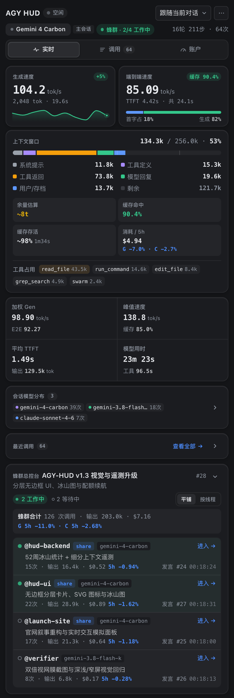
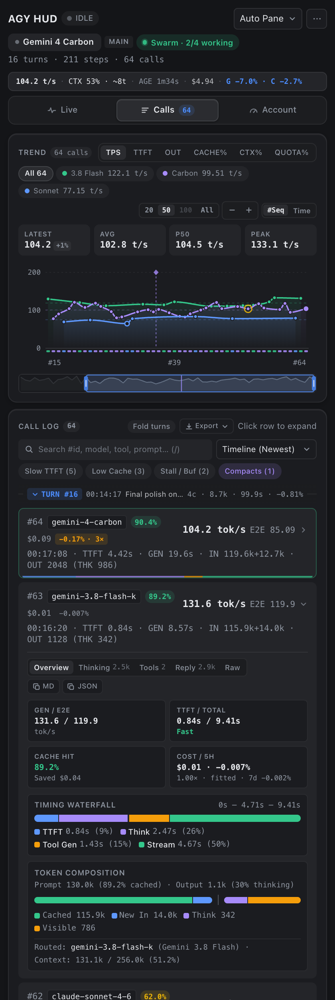
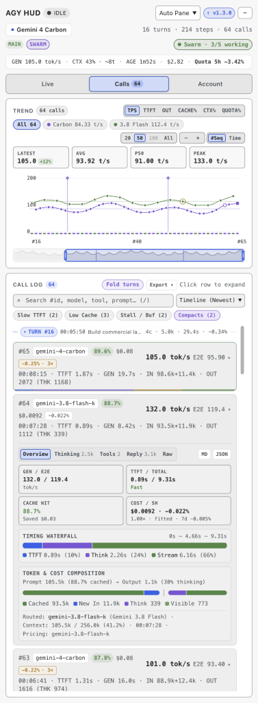
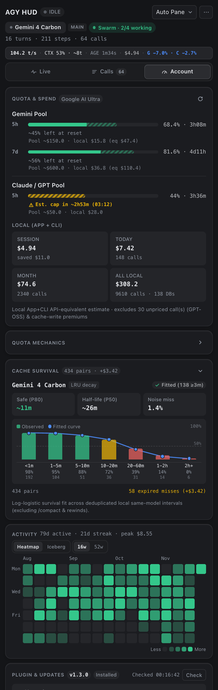

# AGY-HUD 完整使用与技术指南

> [English](GUIDE.md) · **简体中文** · [返回首页](../README.zh-CN.md) · [安装与升级指南](INSTALLATION.zh-CN.md)

本文档系统阐述 **AGY-HUD** 的核心功能、交互方式、数据来源、计算公式与底层架构。

---

## 目录

1. [原生 AGY Swarm 蜂群观测驾驶舱](#1-原生-agy-swarm-蜂群观测驾驶舱)
2. [全历史趋势浏览器与缩略图刷选缩放](#2-全历史趋势浏览器与缩略图刷选缩放)
3. [OpenRouter 风格调用详情检视器、检索与导出](#3-openrouter-风格调用详情检视器检索与导出)
4. [实时页签诊断与会话模型构成](#4-实时页签诊断与会话模型构成)
5. [智能中文环境启发式识别与缓存机制](#5-智能中文环境启发式识别与缓存机制)
6. [核心指标公式与 Protobuf 字段映射](#6-核心指标公式与-protobuf-字段映射)
7. [实测配额 `k` 倍率拟合与 5h/7d 续航模型](#7-实测配额-k-倍率拟合与-5h7d-续航模型)
8. [快捷键与本地 Sidecar HTTP 接口参考](#8-快捷键与本地-sidecar-http-接口参考)

---

## 1. 原生 AGY Swarm 蜂群观测驾驶舱

<div align="center">
  
  <br />
  <sub>实时页签中的原生 AGY Swarm 蜂群驾驶舱：展示实时脉冲状态、<code>@rosterName</code> 徽章、任务摘要、公告板 <code>Board #seq</code> 与全群配额汇总。</sub>
</div>

### 蜂群自动发现原理（`lib/swarm.ts`）

AGY-HUD 在所有已发现的 `appDataDir` 根目录下以**严格只读模式**扫描 Antigravity 原生蜂群目录：

```text
<appDataDir>/brain/<coordinator_conv_id>/.system_generated/swarm/
├── swarm.json      # { version, backend, swarm_id, created_at }
├── members.json    # { title, members: { "<rosterName>": { conversation_id, role, phase, desired_state, wake_mode, killed, applied_model, workspace_mode, last_read_seq } } }
├── plan.json       # { goal: { title, line }, tasks: { "<rosterName>": "..." }, threads: [{ id, title, goal, tasks }] }
└── board.jsonl     # 追加写入的公告板日志 { seq, agent, text, time, kind }
```

- **近零开销 `mtime` 缓存**：每个蜂群目录按四个文件的联合 `mtimeMs:size` 签名缓存解析结果，`brain/` 目录列表也按目录 `mtimeMs` 缓存，稳态轮询几乎不产生 CPU 与磁盘 I/O。
- **有界公告板读取**：面对超长 `board.jsonl`，后端仅读取末尾 **64 KB** 提取最新 `boardSeq` 及各成员最近一条发言摘要（120 字符）；仅当 `plan.json` 缺少某工作节点任务描述时，才额外扫描文件开头 **32 KB** 提取初始任务简报。
- **反向索引关联**：建立 `workerConvId -> { coordinatorConvId, rosterName, swarm, member }` 反向映射。即便 SQLite `parent_references` 尚未落盘，协调者与全部工作节点也能即时关联。

### 成员实时状态判定规则

| 状态指示器 | 状态名 | 判定依据（`members.json`） |
| :---: | :--- | :--- |
| 绿色脉冲圆点 | **`working`（工作中）** | 未被终止，`phase === 'RUNNING'`（或 `desired_state === 'RUNNING'`），且 `wake_mode === 'working'` |
| 灰色空心圆环 | **`waiting`（等待中）** | 运行中但正挂起等待公告板唤醒（`wake_mode !== 'working'`） |
| 琥珀色方块 | **`stopped`（已停止）** | `phase === 'STOPPED'`，或 `phase` 与 `desired_state` 均非 `'RUNNING'` |
| `×` + 删除线 | **`killed`（已终止）** | `killed === true`，或 `phase`/`desired_state === 'KILLED'` |

### 驾驶舱核心能力

- **蜂群总览与汇总条**：展示蜂群标题、`plan.json` 目标副标题、实时状态统计（工作中 / 等待 / 停止 / 已终止）、`Board #seq` 进度，以及协调者 + 全部工作节点的**调用总数、输出 Token、美元成本与 5h/7d 配额消耗总计**。
- **高信息密度成员卡片**：默认按**活跃优先**排序（`working → waiting → stopped → killed`，同状态按最新活动时间倒序）。每张卡片展示 `@rosterName`、独立工作树徽章（突出显示 `share` / `branch`）、路由模型标签、1–2 行截断任务摘要、对齐等宽指标、最近发言 `#seq`，悬停可查看最新公告板摘录与阅读进度（`lastReadSeq / boardSeq`）。
- **按线程分组**：当 `plan.json` 定义了多个并行线程时，自动显示 **`平铺 | 按线程`** 切换胶囊，支持折叠/展开各工作线程。
- **工作节点面包屑（`SessionRelBar` 与会话下拉框）**：点击跳转到任意工作节点后，顶部关系栏自动显示 `← @coordinator · <蜂群标题>` 与当前 `@rosterName` 状态徽章，顶部会话选择器也会清晰标注 `[Swarm @rosterName]`。

---

## 2. 全历史趋势浏览器与缩略图刷选缩放

<div align="center">
  
  <br />
  <sub>调用页签：全历史趋势图、可交互缩略图刷选条、视口四格汇总指标及展开后的 OpenRouter 风格详情检视器。</sub>
</div>

**调用趋势图（`TrendChartCard.tsx`）** 完全由原生 SVG + Preact 实现（零图表库依赖），支持浏览整场会话的每一次调用：

### 六大指标与叠加参考层

| 指标 | 图表形式 | 叠加视觉标注 | 视口四格汇总条（随缩放实时重算） |
| :--- | :--- | :--- | :--- |
| **`速度 (TPS)`** | 单调三次平滑曲线 + 渐变面积 | 5 次调用 EMA 虚线趋势（`n ≥ 6`）；`BUF` 空心环；`TC-WAIT` 琥珀警告环 | `最新 + 差值%` · `均值`（持续流式）· `P50` · `峰值` |
| **`首字 (TTFT)`** | 单调平滑曲线 + 面积 | `3s` / `10s` SLA 参考线；右标 `P95` 虚线；按延迟档位着色的数据点 | `最新 + 差值%` · `均值` · `P95` · `最大` |
| **`输出 (OUT)`** | 圆角堆叠柱（紫色思考 + 绿色正文） | 5 次调用 EMA 折线 | `最新` · `均值` · `思考占比` · `总计` |
| **`缓存 (CACHE)`** | 单调平滑曲线 + 面积 | `80%` 目标虚线；低于 `40%` 标红警示点 | `最新 + 差值pp` · `均值` · `最低` · `≥80% 次数` |
| **`上下文 (CTX)`** | 单调平滑曲线 + 面积 | `80%–100%` 压缩预警阴影带 + 压缩菱形标记 | `最新` · `剩余轮次 (~Nt)` · `峰值` · `压缩次数` |
| **`配额% (QUOTA%)`** | 圆角柱状图（`k ≥ 1.8×` 高倍率高亮） | 视口均值线 | `最新` · `均值` · `峰值` · `累计消耗` |

- **跨指标压缩标线**：上下文压缩事件会在**全部 6 个指标**上绘制垂直紫色虚线与顶部菱形，便于直观观察压缩后缓存命中率下跌或 TTFT 变化。
- **规整 Y 轴刻度**：`CACHE` 与 `CTX` 固定 `0 / 50 / 100%`；其余指标按 `1 / 2 / 2.5 / 5 × 10^k` 自动向上取整，无需悬停即可一眼读数。

### 历史导航与缩放手势

1. **范围预设（`20 | 50 | 100 | 全部`）**：偏好自动持久化到 `localStorage`，超长会话默认聚焦最近 50 次调用。
2. **可交互缩略图刷选条（Minimap Brush）** *（筛选后调用数 `> 8` 时显示）*：
   - 在 X 轴下方呈现整场会话的全局轮廓及压缩标记。
   - **拖拽左右手柄**：无级调整视口跨度（最小跨度 `4` 次调用）。
   - **拖拽视口主体**：左右平移历史区间；拖至最右端时自动重新开启 `跟随最新`。
   - **单击外部暗色轨道**：瞬间将视口居中跳转到点击位置。
   - **双击缩略图**：一键重置为 `全部` + `跟随最新`。
3. **主画布拖选缩放与滚轮/触控板控制**：
   - **横向拖拽（`≥ 8 px`）**：拉出选区框并立即缩放至该历史区间。
   - **单击（移动 `< 6 px`）**：直接定位并展开下方调用日志中对应的调用。
   - **`Ctrl` / `Cmd` / `Shift` + 鼠标滚轮**：以鼠标位置为锚点平滑缩放（普通纵向滚动绝不劫持页面滚动）。
   - **缩放状态下触控板横向滑动**：平滑左右平移历史视口。
   - **`[-]` / `[+]` 缩放微调按钮** 与 **`#序号` / `时间` X 轴切换**（等距序号槽位 vs 按 `timestampMs` 真实时间间隔排布）。
4. **智能 `跟随最新 ⏭` 状态机**：默认锁定在最新调用右侧；一旦向左平移或放大历史片段，即自动暂停跟随并浮现 `正在查看 #A–#B / 共 N 次 · [跟随最新 ⏭]` 横幅，确保新调用到来时绝不抢走你正在排查的画面。
5. **零延迟十字准星**：`0 ms` 实时捕捉最近数据点，绘制纵横细线与光晕，并在图表内展示结构化浮卡（`#序号`、路由模型、时间、异常徽章、主值与均值差、2×2 伴随指标）。

---

## 3. OpenRouter 风格调用详情检视器、检索与导出

### 折叠行与 2px 底部耗时比例细线

每条折叠调用记录均展示 `#序号`、实际路由模型标签、缓存命中胶囊、异常微标签（`BUF`、`TC-WAIT`、平铺视图下的 `T#N` 轮次标）、美元成本、`-配额%` 胶囊（未充分拟合时带 `~` 前缀，高倍率模型显示 `· 3×`）、`GEN tok/s` 与 `E2E tok/s`。行底部的 **2px 耗时比例细线**用蓝（`TTFT`）、紫（`思考`）、琥珀（`工具参数生成`）、绿（`正文流式输出`）直观呈现阶段占比，浏览列表时一眼即可发现首字慢或工具卡顿的请求。

### 展开后的五页签详情检视器（`InvocationRow.tsx`）

单击调用行后，`概览`页签瞬时渲染，同时通过 `/api/call-detail` 按需懒加载完整正文与工具参数（上限 `60,000` 字符）：

1. **`概览 (Overview)` *（默认）***：
   - **四格指标汇总条**：`GEN / E2E`、`TTFT / 总耗时`（带延迟档位着色）、`缓存命中`（含节省金额）以及 `成本 / 配额`（`5h`/`7d`、`k×` 倍率及拟合/预估状态）。
   - **分阶段耗时瀑布图**：按比例绘制 `TTFT 等待`、`思考`、`工具参数生成 / TC-WAIT`（卡顿时带警告斜纹）与 `正文流式输出`（最小可见宽 `3%`），附带 `秒数 (%)` 图例。
   - **Token 与成本构成条**：左侧拆解提示词的 `缓存命中` 与 `新输入`，右侧拆解输出的 `思考` 与 `可见回复`；底部标明真实路由 `modelId`、UI 别名 `modelDisplay`、精确 `上下文用量 / 上限 (%)` 与时间戳。
2. **`思考 (Thinking)`**：独立可滚动推理过程窗格，附字数统计与 `[复制]` 按钮。
3. **`工具 (Tools)`**：结构化工具调用卡片，高亮工具名、自动格式化 JSON 参数并支持单工具 `[复制参数]`。
4. **`回复 (Reply)`**：清晰可滚动回复正文窗格，支持一键 `[复制]`。
5. **`原始数据 (Raw)`**：完整调用 JSON 视图，页签栏右上角常驻 `[MD]` 与 `[JSON]` 快捷复制按钮。

### 调用日志检索、筛选与一键报告导出（`CallLogCard.tsx`）

在完整 **调用** 页签中提供：

- **即时搜索（`/` 快捷键聚焦）**：支持按 `#序号`、路由 `modelId`、显示名、用户提示预览、工具名及已加载的思考/回复内容匹配。
- **多维度排序**：`时间线（最新优先）` *（保留轮次分组）*、`总耗时最慢`、`TTFT 最高`、`GEN TPS 最低`、`成本 / 配额最高` *（非时间线模式自动转为带 `T#N` 轮次标的扁平排行）*。
- **异常与模型筛选胶囊** *（命中数为 0 时自动隐藏）*：
  - `慢首字 (>3s)` · `低缓存 (<60%)` · `卡顿 / 单包` · `仅压缩 (N)`
  - 与上方趋势图实时联动的 `模型` 筛选胶囊。
- **图表联动定位**：单击趋势图任意点/柱自动展开对应轮次与调用行，平滑滚动至视野内并闪烁 1.2 秒高亮框。
- **一键导出诊断报告（`web/src/utils/exportReport.ts`）**：
  - **单次调用（`[MD]` / `[JSON]`）**：复制 GitHub 风格 Markdown 诊断卡片或结构化 JSON。
  - **整场会话（顶部 `⋯` 菜单或调用日志 `[导出]` 按钮）**：
    - `复制会话报告 (MD)`：包含路由模型分布表、P50/P95 TTFT、均值/峰值 GEN TPS、上下文曲线、配额消耗、最慢/最贵 Top 5 调用与压缩记录。
    - `导出遥测数据 (JSON)`：下载 `agy-hud-<shortId>.json`（若宿主 WebView 限制文件下载，自动降级为复制到剪贴板）。

---

## 4. 实时页签诊断与会话模型构成

- **主速度卡片（`HeroSpeedCards.tsx`）**：展示实时 `GEN TPS` 与 `E2E TPS`、相对会话均值的**涨跌幅百分比徽章**，以及近 **8 次调用的内联迷你折线图**（`≥ 3` 次调用时显示）。
- **上下文窗口透视（`ContextWindowCard.tsx`）**：将活跃提示词拆分为 5 大桶 —— `系统提示`、`工具定义`、`工具返回`（附按单工具 Token 占用排行）、`模型回复` 与 `用户 / 检查点`，并给出中位增量**剩余可用轮次（`~Nt`）**与**提示词缓存年龄**。
- **条件式会话模型构成卡（`LiveTab.tsx`）**：当同一会话中出现 **2 个及以上实际路由模型**（如 `gemini-4-carbon` 与 `gemini-3.8-flash-k`）时，自动浮现可折叠的模型构成对比表，横向比较各模型的调用次数、持续 `GEN TPS`、平均 `TTFT`、缓存命中率、美元成本与 `5h` 配额消耗。
- **宿主主题同步（`useThemeSync.ts`）**：自动跟随 Antigravity 的 `浅色 (light)`、`深色 (dark)` 与 `高对比度 (strong)` 变量及字号缩放。

<div align="center">
  
  <br />
  <sub>自动同步 Antigravity 浅色宿主主题，保持清晰的 1px 细线表面层级与语义色板。</sub>
</div>

---

## 5. 智能中文环境启发式识别与缓存机制

首次启动且用户未在 `localStorage` 中手动指定语言时，前端会请求 `GET /api/locale`（由 `plugin/sidecars/hud_panel/lib/locale.ts` 实现）。

### 多信号加权评分模型（`总分 ≥ 0.60 → 中文`，否则 `英文`）

| 检测信号 | 权重 | 探测方式（无 Shell 调用、有超时保护） |
| :--- | :---: | :--- |
| **主语言环境（Primary Locale）** | **`+1.00`** | `LC_ALL` / `LC_MESSAGES` / `LANG` / `LANGUAGE[0]`、系统首选语言（macOS `defaults read -g AppleLanguages`、Windows PowerShell `CurrentUICulture` / 注册表、Linux `/etc/locale.conf`）或 `Intl` 语言匹配 `zh` / `cmn` / `yue` |
| **次选语言（Secondary Locale）** | **`+0.45`** | 系统语言列表第二及后续项或 `LANGUAGE` 回退列表（仅当主语言非中文时计分） |
| **中文地区子标签（Region Tag）** | **`+0.35`** | 地区子标签含 `CN` / `TW` / `HK` / `MO` 或 `@rg=cn/tw/hk/mo`（例如 `en_CN`） |
| **中国/华语时区（Timezone）** | **`+0.35`** | `Asia/Shanghai`、`Asia/Chongqing`、`Asia/Hong_Kong`、`Asia/Taipei`、`Asia/Macau`、`Asia/Urumqi`、`PRC` 等 |
| **中文输入法（Input Method）** | **`+0.30`** | macOS `com.apple.HIToolbox`（系统拼音/五笔/注音、搜狗、百度、鼠须管 Rime、微信输入法 WeType、讯飞、字节等）；Linux `XMODIFIERS`/`IBUS_ENGINE`/`FCITX_ADDON` |
| **用户自装中文字体** | **`+0.30`** | 扫描用户字体目录（`~/Library/Fonts`、`AppData\Local\Microsoft\Windows\Fonts`、`~/.local/share/fonts`）中的中文命名或常见中文字体（霞鹜文楷、思源黑/宋体 SC/TC、Noto SC/TC、更纱黑体、鸿蒙黑体、Maple Mono CN 等，自动排除日/韩字体） |
| **Linux 系统级中文字体** | **`+0.25`** | `/usr/share/fonts` 或 `fc-list :lang=zh` |
| **Windows 系统级中文字体** | **`+0.15`** | `C:\Windows\Fonts` |
| **macOS 系统预装中文字体** | **`0.00`** | 明确归零 —— 因为所有英文 macOS 均在 `/System/Library/Fonts` 预装了 `PingFang.ttc`，避免英文用户被误判为中文！ |

### 持久化缓存与手动优先级

- **7 天缓存**：探测结果同时保存在内存和磁盘（`<appDataDir>/.agy-hud-cache/locale.json` 或 `$ANTIGRAVITY_EXECUTABLE_DATA_DIR/locale-cache.json`，支持通过 `AGY_HUD_LOCALE_CACHE_PATH` 自定义，失败自动回退至系统临时目录）。
- **指纹自动失效**：基于 `(platform, LC_ALL, LC_MESSAGES, LANG, LANGUAGE, TZ, intlLocale, intlTimeZone)` 生成指纹，系统环境变化时自动重探；调用 `GET /api/locale?refresh=1` 亦可强制刷新。
- **手动切换优先**：在顶部 `⋯` 菜单点击 **`EN / 中文`** 后，你的显式选择会写入 `localStorage` 并始终优先于启发式探测。

---

## 6. 核心指标公式与 Protobuf 字段映射

### 核心指标公式

| 指标 | 计算公式 / 规则 | 说明 |
| :--- | :--- | :--- |
| **`GEN TPS`** | `outputTokens / genSec` | 首字输出之后的持续流式生成速率。 |
| **`E2E TPS`** | `outputTokens / (ttftSec + genSec)` | 包含首字等待（`TTFT`）在内的端到端吞吐速率。 |
| **`BUF` 标记** | `genSec < 0.5 \|\| (genSec < 1.0 && genTps > 1200)` | 识别单包缓冲突刺响应；自动从 `PEAK TPS` 与加权 `AVG GEN`（`sustainedOutput / sustainedGenSec`）中剔除，确保均值绝不会高于峰值。 |
| **`缓存命中率`** | `cachedInput / (cachedInput + newInput) × 100` | 单次调用及整场会话的提示词前缀缓存覆盖比例。 |
| **`TC-WAIT`** | 在 `genSec` 内拆分 `thinkSec` 与 `toolGenSec` | 识别工具参数流式生成卡顿，并将 `TOOL TIME` 起点钳制在模型规划完成之后。 |
| **`剩余可用轮次`** | `(contextLimit - totalContext) / medianContextDelta` | 按近期上下文中位增量估算触发压缩前剩余的对话轮数。 |

### SQLite 与 Protobuf 字段映射

AGY-HUD 通过 `new DatabaseSync(dbPath, { readOnly: true })` 只读读取 `~/.gemini/antigravity/conversations/<uuid>.db`（含 `-wal`），并自动发现合并 App、CLI（`agy`）、ACP 与 IDE 多端数据目录：

| 表 / 字段路径 | 解析含义 | 回退策略 |
| :--- | :--- | :--- |
| `gen_metadata.f1.f19` | **实际路由的后端模型标识**（如 `gemini-4-carbon`、`gemini-3.8-flash-k`） | 前端展示别名（`f1.f21`）或枚举（`f1.f3` / `f1.f20`） |
| `gen_metadata.f1.f4` | `newInput`（`f2`）、`outputTokens`（`f3`）、`cachedInput`（`f5`）、`botId`（`f7`）、`thinkingTokens`（`f9`）、`candidateTokens`（`f10`）、`modelEnum`（`f1`） | 旧版用量字段（`f1.f17.f2`） |
| `gen_metadata.f1.f9.f10` | 上报活跃上下文长度（`f1`）与真实窗口上限（`f4`，如 `256,000`） | `cachedInput + newInput`；内置模型上限表 |
| `gen_metadata.f1.f11` / `f1.f12` | 首字延迟 `TTFT`（`f11`）与流式生成时长（`f12`） | `0.0s` |
| `gen_metadata.f1.f20` | 键值元数据：`last_step_index`、`model_enum`、`parent_cascade_id`、`subagent_type` | — |
| `steps`（`status != 3`） | 进行中生成步骤（`step_type = 15`）、上下文压缩（`step_type = 23`）、工具执行态（`TOOL`）及步骤时间戳 | 回环 LS 轨迹 RPC |

---

## 7. 实测配额 `k` 倍率拟合与 5h/7d 续航模型

<div align="center">
  
  <br />
  <sub>账户页签：5h/7d 双配额池续航预测、实测 <code>k</code> 倍率规则卡、多端消费统计、16 周热力图与插件自升级。</sub>
</div>

Antigravity 按模型池（`gemini` 与 `claude_gpt`）实施滚动 **5 小时（`5h`）**与 **7 天（`7d`）**配额限制。AGY-HUD 的统计求解器（`lib/quota-solver.ts` 与 `lib/quota-fitter.ts`）通过实测数据校准每个模型家族的真实消耗规则：

1. **固定基准参考成本**：将每次调用的 `[newInput, cachedInput, outputTokens]` 投影到时间不变的官方目录价参考向量（`pricing.json`）得到 `baseUSD`。
2. **结构先验与配额池容量 $F$**：
   - 将 5h 满池等价目录价容量定义为 $F = 100 / \beta_{\text{ref}}$，初始先验为 `F_gemini = $150`、`F_claude_gpt = $11.35`，`7d/5h` 比例先验为 $\gamma_{\text{gemini}} = 4.0$、$\gamma_{\text{claude\_gpt}} = 2.0$，模型家族倍率先验为 `k = 1.0×`（`flash` / `hydrogen` / `neon` / `claude` / `gpt-oss`）与 `k = 3.0×`（`carbon` / `argon`）。
3. **短窗口训练与长窗口远程差值分离**：
   - 仅使用干净的**短观测窗口（`≤ 15 分钟` / `900 s`）**且配额快照时间未落在调用边界 `±1.5 s` 不确定区间内的样本训练 `k` 与 $\beta$。
   - 长窗口绝不污染参数拟合，而是专门用于估算**未归因远程配额消耗**（来自其他设备或网页端的消耗）。
4. **鲁棒 IRLS 回归与异常值剔除**：
   - 采用对称 Huber/Tukey 迭代加权最小二乘法（IRLS）与自适应 **MAD `6σ` 异常值剔除**，避免配额扣减边界抖动或缓存刷新毛刺拉偏拟合结果。
   - 对 Claude 系列（`claude-opus-5-5`、`claude-sonnet-5-5`）启用三参数正则化岭回归 `[w_in, w_cache, w_out]`（%/M tokens），在满足 `≥ 20` 个干净短窗口、`≥ 5` 个留出验证样本且**样本外误差（OOS）`≤ 2%`** 之前均稳健标注为 **`预估 (provisional)`**（`~-X%`）。
5. **耗尽续航预测（Runway ETA）**：结合当前剩余百分比、重置倒计时与近期观测消耗速率，实时计算在窗口重置前是否会提前耗尽及预计耗尽时刻。

---

## 8. 快捷键与本地 Sidecar HTTP 接口参考

### 快捷键与手势汇总

| 快捷键 / 手势 | 生效场景 | 功能 |
| :--- | :--- | :--- |
| `1` / `2` / `3` | 侧边栏获得焦点（非输入控件） | 切换 **实时** / **调用** / **账户** 页签 |
| `/` | 侧边栏获得焦点（非输入控件） | 聚焦调用日志搜索框（自动切换至 **调用** 页签） |
| `Esc` | 侧边栏任意位置 | 清空搜索词、关闭 `⋯` / 导出菜单、取消图表悬停 |
| 横向拖拽（`≥ 8 px`） | 趋势图主画布 | 拉框缩放选定历史区间 |
| 单击（`< 6 px`） | 趋势图主画布 | 跳转并展开调用日志中对应调用 |
| `Ctrl` / `Cmd` / `Shift` + 滚轮 | 趋势图主画布 | 以鼠标为中心平滑缩放 |
| 触控板横向滑动 | 趋势图主画布（缩放中） | 平滑左右平移 |
| 双击 | 趋势图缩略图刷选条 | 重置为 `全部` + `跟随最新` |

### 本地 Sidecar HTTP 接口（`server.ts`）

| 方法与路径 | 参数 / 请求体 | 用途 |
| :--- | :--- | :--- |
| `GET /api/stats` | `mode`、`conversationId`、`refreshQuota`、`etag` | 主遥测快照接口，ETag 增量校验（活跃 `500 ms` / 空闲 `1500 ms` 轮询） |
| `GET /api/call-detail` | `conversationId`、`kind`（`inv`\|`compact`\|`turn`）、`id` | 按需获取单次调用完整思考/回复/工具参数（上限 `60k` 字符） |
| `GET /api/locale` | `refresh=1` *（可选）* | 返回启发式中文/英文检测结果、分项得分与缓存状态 |
| `GET /api/update-status` | `force=1` *（可选）* | 检查 GitHub 最新版本（6 小时缓存）与安装模式（`isLinked`、`canSelfUpdate`） |
| `POST /api/update-apply` | `{ force?: boolean }` | 执行安全自升级（含 SHA-256 后端变更比对、原子替换与优雅重启） |
